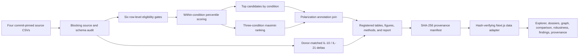

# Full Project Report

## From reproducible Perturb-seq triage to an interactive analyst workbench

**Project:** Verified primary human CD4+ T-cell Perturb-seq source-QC triage  
**Report date:** 27 July 2026  
**Implementation status:** Complete, locally runnable, production-buildable, and technically verified  
**Interactive UI:** `http://127.0.0.1:3000` while the local development server is running  
**Authoritative analysis bundle:** `output/official`  
**Pinned upstream source commit:** `848d62fc2b7027f7218d6fc5f5b0c37255dc94af`

---

## Executive summary

This project answers a practical scientific decision question:

> Within Rest, Stim8hr, and Stim48hr, which gene perturbations show broad source-reported downstream transcriptional consequences while also passing predeclared checks for effective negative on-target knockdown, minimum cell support, absence of a source off-target flag, and positive source-reported donor and guide concordance? Which genes pass that evidence package in all three conditions?

The official study contains approximately 22 million primary human CD4+ T cells. Its 12 cell-level files total about **1.58 TiB**, which is too large for a lightweight, broadly reproducible analyst workflow. We therefore built a transparent **summary-level source-QC and prioritization pipeline** over four immutable, commit-pinned supplementary tables totaling about **7.62 MiB**. This is roughly **217,000 times smaller** than the cell-level dataset.

The pipeline audits the sources, applies six predeclared eligibility gates, computes a balanced within-condition priority score, finds candidates that remain eligible in all three conditions, adds source-authored polarization context, and summarizes donor-matched IL-10/IL-21 follow-up measurements. It produces a hash-registered bundle of tables, figures, methods, reports, and provenance records.

The pinned run starts from **33,983 perturbation-condition rows**. It retains **1,652 eligible rows across 981 genes**, and **224 genes** pass all gates in Rest, Stim8hr, and Stim48hr. **SETDB1** is the leading cross-condition candidate under the registered maximin rule: its weakest condition score is **0.914689**.

We then built a dark-mode Next.js analyst workbench that turns those static outputs into a task-oriented investigation environment. Analysts can explore and compare candidates, inspect a gene-centered evidence graph, test ranking sensitivity, draft bounded finding cards, and inspect complete provenance. The UI reads the authoritative output bundle directly, verifies artifact hashes before use, and visibly separates registered results, derived summaries, source annotations, descriptive follow-up, and missing evidence.

The result is not an automated target-discovery claim and not an independent validation study. It is an auditable decision-support system that helps an expert decide which candidates deserve closer review and which evidence should be collected next.

---

## 1. Project at a glance

| Item | Result |
|---|---|
| Biological setting | Primary human CD4+ T-cell Perturb-seq |
| Screen design | Four donors; Rest, Stim8hr, and Stim48hr |
| Official source rows | 33,983 perturbation-condition rows |
| Source-QC passing rows | 1,652 |
| Distinct eligible genes | 981 |
| Cross-condition eligible genes | 224 |
| Presentation shortlist | 15 candidates per condition; 45 rows and 31 unique genes |
| Leading maximin candidate | SETDB1 |
| SETDB1 weakest-condition score | 0.914689 in Stim8hr |
| Analysis outputs | 17 registered artifacts: 9 CSV, 4 PNG, 2 Markdown, and 2 JSON |
| Analyst interface | Seven task-oriented Next.js routes |
| Knowledge graph stack | React Flow with deterministic ELK layered layout |
| Integrity model | Pinned sources, source SHA-256 checks, manifest fingerprinting, and artifact hash verification |
| Current validation | 32 Python tests passed; Ruff, TypeScript, ESLint, and production build passed |

---

## 2. The problem and why it matters

### 2.1 The scientific problem

Large perturbation screens generate many candidate effects, but a long ranked list is not the same as a defensible biological conclusion. An analyst still needs to know:

- whether the target perturbation behaved in the intended CRISPRi direction;
- whether the result had enough cell support;
- whether the source analysis raised an off-target concern;
- whether the result was directionally concordant across donors and guides;
- whether a candidate is strong only in one condition or remains supported across all conditions;
- which evidence is source-reported, which is recomputed here, and which is still missing.

Without those distinctions, a single score can hide weak evidence, annotations can be mistaken for independent validation, and analysts can spend time manually cross-referencing disconnected CSV files.

### 2.2 The decision this project supports

The project supports **triage before expensive follow-up**. It helps a computational biologist or experimental T-cell scientist decide:

1. which perturbations pass a consistent source-QC evidence package;
2. which candidates should be reviewed within each condition;
3. which genes remain eligible across Rest, Stim8hr, and Stim48hr;
4. what source annotations or descriptive follow-up exist;
5. what experiment would be required to move from prioritization to stronger evidence.

It does **not** decide that a gene is therapeutic, safe, causal in a new population, druggable, or independently validated.

An honest empty shortlist is an acceptable analytical outcome. The pipeline must never relax a
gate merely to manufacture a headline.

### 2.3 Claim ladder

The project uses the following evidence ladder:

1. **Present in the source table** — the gene-condition result exists.
2. **Eligible/source-QC pass** — the row passes all six registered gates.
3. **Prioritized within a condition** — the eligible row ranks highly under the registered balanced score.
4. **Cross-condition candidate** — the gene is eligible in all three conditions and ranks well by its weakest score.
5. **Independently validated** — requires a new, powered, orthogonal experiment and is not established by this project.

This ladder is central to the analysis and the interface. The UI deliberately uses language such as “candidate,” “source-QC pass,” “descriptive follow-up,” and “evidence gap” instead of presenting prioritization as proof.

---

## 3. Data scope and provenance

### 3.1 Why summary-level analysis was selected

The 12 cell-level `.h5ad` files total **1,735,835,115,866 bytes**, approximately **1.58 TiB**. Reprocessing that full dataset would require materially more storage, memory, compute, and runtime, and would make the project difficult to reproduce on an ordinary analyst machine.

The selected four supplementary CSVs total **7,985,758 bytes**, approximately **7.62 MiB**. The workflow therefore audits and transforms the source authors’ published summaries rather than refitting the raw single-cell model.

This route provides:

- reproducibility on a normal computer;
- clear source-to-output lineage;
- deterministic reruns;
- a narrow and honest claim: source-QC triage and prioritization, not raw-cell reanalysis.

### 3.2 Immutable official inputs

| Input | Registered role | Audited shape | Bytes | SHA-256 |
|---|---|---:|---:|---|
| `DE_stats.suppl_table.csv` | Gene-condition results and all gate/ranking fields | 33,983 × 19 | 5,341,369 | `66fb80b93ef107095a8218efa06a5b272093d9343e9009b3ea4a88ba3cafdead` |
| `sample_metadata.suppl_table.csv` | Study-design audit | 12 × 18 | 2,966 | `766134d11dabb5d63388e00b4d687a809c0254eb3c19d77f439a6bf9dad7abd4` |
| `IL10_IL21_arrayed_validation.csv` | Descriptive donor-matched cytokine follow-up | 53 × 5 | 2,200 | `f60cdda392d6f29d10a539727ff7324b04d17e35c0512c889b733e00380b83dc` |
| `polarization_prediction_condition_comparison_regulator_coefficients.csv` | Descriptive activation/polarization context | 23,172 × 9 | 2,639,223 | `57e57c9a825b4d49a3fff6c4e529bb3366c432d3639d026953addfcfe19ac25f` |

The downloader writes each source to a temporary file, checks its byte length and SHA-256 digest, and only then installs it. The exact source definitions are in `src/tcell_perturbseq/sources.py`, and the completed audit is in `output/official/provenance/source_audit.json`.

### 3.3 Screen design represented in the metadata

| Condition | Samples | Donors | Libraries/runs represented |
|---|---:|---:|---:|
| Rest | 4 | 4 | 2 runs |
| Stim8hr | 4 | 4 | 2 runs |
| Stim48hr | 4 | 4 | 1 run |

The metadata is used to expose and audit the study design. This project does not fit a new donor or batch model from the metadata.

---

## 4. Scientific and analytical method

### 4.1 End-to-end workflow



### 4.2 Blocking source audit

Before any ranking is computed, the workflow:

- verifies that all required tables and columns are present;
- strictly parses declared Boolean fields;
- rejects nonnumeric text in declared numeric fields;
- rejects duplicate gene-condition keys;
- checks that Rest, Stim8hr, and Stim48hr are present;
- rejects duplicate sample IDs;
- verifies that each arrayed-follow-up donor has a recognized NTC-family control;
- verifies the pinned source byte sizes and SHA-256 hashes in a normal CLI run.

The run stops if the audit fails. The pinned official inputs passed all recorded checks.

### 4.3 Six registered eligibility gates

Every perturbation-condition row must pass all six conceptual gates:

| Gate | Exact rule | Purpose |
|---:|---|---|
| 1 | `ontarget_significant == True` | Require the source authors’ significant on-target call at their 10% FDR threshold |
| 2 | `ontarget_effect_size < 0` | Require the intended negative CRISPRi direction |
| 3 | `offtarget_flag == False` | Exclude rows flagged by the source off-target field |
| 4 | `n_cells_target >= 100` | Require minimum targeted-cell support |
| 5 | `crossdonor_correlation_min` is present and `> 0` | Require measured, positive donor concordance |
| 6 | `crossguide_correlation` is present and `> 0` | Require measured, positive guide concordance |

Conservative missing-value behavior is intentional:

- missing on-target significance is treated as a failure;
- missing off-target status is treated as flagged;
- missing, zero, or negative donor and guide correlations fail;
- every source row is retained in the decision table with individual gate flags and semicolon-delimited failure reasons.

The row-level implementation is in `src/tcell_perturbseq/analysis.py`, and all decisions are available in `output/official/tables/source_qc_decisions.csv`.

### 4.4 Sequential filter funnel

The gates are applied cumulatively and separately within each condition:

| Cumulative stage | Rest | Stim8hr | Stim48hr | Total |
|---|---:|---:|---:|---:|
| All source rows | 11,287 | 11,415 | 11,281 | 33,983 |
| On-target significant | 6,869 | 7,154 | 7,193 | 21,216 |
| Negative on-target effect | 6,869 | 7,153 | 7,193 | 21,215 |
| No source off-target flag | 6,063 | 6,289 | 6,410 | 18,762 |
| At least 100 targeted cells | 5,905 | 6,103 | 6,230 | 18,238 |
| Positive, measured donor metric | 806 | 859 | 873 | 2,538 |
| Positive, measured guide metric | **497** | **593** | **562** | **1,652** |

The final pass rates are:

- **Rest:** 497 / 11,287 = **4.4033%**
- **Stim8hr:** 593 / 11,415 = **5.1949%**
- **Stim48hr:** 562 / 11,281 = **4.9818%**
- **Overall:** 1,652 / 33,983 = **4.8613%**

The donor-correlation gate is the largest sequential reduction: it removes 5,099 Rest rows, 5,244 Stim8hr rows, and 5,357 Stim48hr rows after the cell-support gate. That means those rows lack the registered reproducibility evidence; it does not prove that they are biologically irrelevant.

The registered funnel figure visualizes the same cumulative values shown in the table above: a
large initial reduction at on-target significance, modest reductions at direction/off-target/cell
support, the largest sequential reduction at donor concordance, and the final guide-concordance
filter.

### 4.5 Within-condition priority score

Only eligible rows are scored. Within each condition, the workflow calculates average percentile ranks for:

- `n_downstream`;
- `crossdonor_min`, renamed from the source `crossdonor_correlation_min`;
- `crossguide`, renamed from the source `crossguide_correlation`.

Pandas uses:

```python
rank(method="average", pct=True)
```

The registered score is the geometric mean:

```text
priority_score =
    (n_downstream_percentile
     × crossdonor_min_percentile
     × crossguide_percentile)^(1/3)
```

The geometric mean rewards balance. One exceptional component cannot fully compensate for a very weak component. This score is a relative prioritization heuristic—not a probability, p-value, FDR, biological effect size, therapeutic score, or validation statistic.

Final within-condition ranks use descending `rank(method="min")`. Tied displays are secondarily sorted by gene, and the presentation shortlist contains the first 15 rows per condition.

Important interpretation details:

- `n_downstream` is the source authors’ count of downstream discoveries at 10% FDR, excluding the on-target effect.
- The count is power-dependent and is not an effect magnitude.
- Donor and guide correlations are source-authored summary fields; this project requires and ranks them but does not recompute them from raw matrices.
- Percentiles are relative to the eligible cohort in each condition.

### 4.6 Cross-condition ranking

A gene enters the cross-condition table only if it has an eligible row in all three conditions.

For each complete gene:

```text
min_priority_score =
    min(Rest score, Stim8hr score, Stim48hr score)

mean_priority_score =
    mean(Rest score, Stim8hr score, Stim48hr score)
```

Genes are ranked primarily by descending minimum score. This is a **maximin** rule: prioritize the candidate with the strongest weakest condition. Display ties are ordered by descending mean score and then gene.

This analysis is descriptive robustness across three separately ranked cohorts. It is not a perturbation-by-condition interaction test, and the three percentile scores are not calibrated on one shared absolute scale.

### 4.7 Polarization annotations

For every gene passing source QC in at least one condition, the workflow performs an exact gene-symbol match against the source-authored polarization coefficient table. It retains the source fields and adds:

- `in_top_candidates_by_condition`;
- `in_cross_condition_candidates`.

These coefficients are not used in the priority score. They provide descriptive same-study context and must not be treated as independent replication.

### 4.8 Donor-matched IL-10 and IL-21 follow-up

The workflow recognizes controls matching exactly, case-insensitively:

```text
NTC, NTC1, NTC2, or NTC3
```

For each donor and cytokine:

```text
control mean =
    mean(available recognized NTC-family measurements)

donor delta =
    perturbation percentage − matched donor control mean
```

It then reports observed donor count, mean, median, minimum, and maximum delta by perturbation. It does not impute missing donor-perturbation pairs and does not compute p-values, confidence intervals, or multiple-testing claims.

Although the upstream filename uses the word `validation`, this report calls the result **descriptive arrayed follow-up**. The experiment is selected, incomplete, uneven across donors, and not a new independent validation designed by this project.

### 4.9 What this project recomputes

The project recomputes:

- source file integrity and schema decisions;
- row-level eligibility flags and exclusion reasons;
- cumulative filter funnels;
- within-condition percentiles, scores, and ranks;
- top-15 subsets;
- cross-condition minimum and mean scores;
- coefficient annotation joins;
- donor-matched cytokine deltas and descriptive summaries;
- figures, methods, reports, run summary, and artifact hashes.

It inherits from the source authors:

- on-target significance and effect estimates;
- off-target flags;
- targeted-cell counts;
- downstream 10%-FDR discovery counts;
- cross-donor and cross-guide correlations;
- polarization coefficients;
- IL-10 and IL-21 percentage measurements.

This boundary prevents the summary-level workflow from being misrepresented as a raw-data reanalysis.

---

## 5. Outputs and key findings

### 5.1 Overall output

The pinned run produces:

- **33,983** audited source rows;
- **1,652** passing gene-condition rows;
- **981** distinct genes passing in at least one condition;
- **45** presentation rows, 15 per condition;
- **31** unique genes among those 45 presentation rows;
- **224** genes passing all six gates in all three conditions.

The 224 complete genes represent **22.83%** of the 981-gene eligible union.

### 5.2 Top five candidates by condition

| Condition | Rank | Gene | Priority score | `n_downstream` | Donor correlation | Guide correlation |
|---|---:|---|---:|---:|---:|---:|
| Rest | 1 | SETDB1 | 0.944710 | 2,290 | 0.735354 | 0.909150 |
| Rest | 2 | PTEN | 0.923753 | 2,928 | 0.756433 | 0.859778 |
| Rest | 3 | ARNT | 0.911855 | 2,319 | 0.751559 | 0.842060 |
| Rest | 4 | PAXIP1 | 0.909954 | 1,070 | 0.764107 | 0.900496 |
| Rest | 5 | EHMT2 | 0.895760 | 1,428 | 0.714236 | 0.862362 |
| Stim8hr | 1 | ARNT | 0.915798 | 2,642 | 0.694714 | 0.863662 |
| Stim8hr | 2 | SETDB1 | 0.914689 | 1,308 | 0.796010 | 0.906993 |
| Stim8hr | 3 | AHR | 0.905467 | 1,776 | 0.686281 | 0.890300 |
| Stim8hr | 4 | PLCG1 | 0.901330 | 5,032 | 0.688258 | 0.821674 |
| Stim8hr | 5 | KDM1A | 0.899507 | 2,300 | 0.691611 | 0.844114 |
| Stim48hr | 1 | ARNT | 0.942418 | 2,946 | 0.714576 | 0.881333 |
| Stim48hr | 2 | TADA2B | 0.921046 | 5,259 | 0.648163 | 0.869591 |
| Stim48hr | 3 | SETDB1 | 0.916577 | 1,183 | 0.763556 | 0.909649 |
| Stim48hr | 4 | KDM1A | 0.912836 | 2,912 | 0.717999 | 0.812541 |
| Stim48hr | 5 | ARHGAP30 | 0.909835 | 1,483 | 0.645519 | 0.912551 |

The registered top-candidate figure presents these candidates by condition. The complete numeric
shortlist is reproduced later in this document, so the figure is not required to recover its
information.

### 5.3 Top cross-condition candidates

Across the 224 complete genes, minimum priority scores range from **0.019738** to **0.914689**, with a median of **0.418467**. The weakest condition is Rest for 88 genes, Stim48hr for 87 genes, and Stim8hr for 49 genes.

| Cross rank | Gene | Rest | Stim8hr | Stim48hr | Minimum | Weakest condition |
|---:|---|---:|---:|---:|---:|---|
| 1 | SETDB1 | 0.944710 | 0.914689 | 0.916577 | **0.914689** | Stim8hr |
| 2 | ARNT | 0.911855 | 0.915798 | 0.942418 | 0.911855 | Rest |
| 3 | AHR | 0.887119 | 0.905467 | 0.909289 | 0.887119 | Rest |
| 4 | NFRKB | 0.889739 | 0.893207 | 0.884501 | 0.884501 | Stim48hr |
| 5 | EHMT2 | 0.895760 | 0.884985 | 0.861686 | 0.861686 | Stim48hr |
| 6 | KDM1A | 0.851361 | 0.899507 | 0.912836 | 0.851361 | Rest |
| 7 | GATA3 | 0.840897 | 0.839572 | 0.905778 | 0.839572 | Stim8hr |
| 8 | TFAM | 0.826303 | 0.863562 | 0.883053 | 0.826303 | Rest |
| 9 | TAF13 | 0.865597 | 0.846008 | 0.822757 | 0.822757 | Stim48hr |
| 10 | PAXIP1 | 0.909954 | 0.832696 | 0.821887 | 0.821887 | Stim48hr |
| 11 | TADA1 | 0.830887 | 0.806418 | 0.833760 | 0.806418 | Stim8hr |
| 12 | SGF29 | 0.806405 | 0.859914 | 0.868250 | 0.806405 | Rest |

The registered cross-condition figure is a heatmap of complete three-condition score profiles. The
full 224-gene numeric ranking is reproduced later in this document.

### 5.4 Lead-candidate case study: SETDB1

SETDB1 leads the cross-condition table because its lowest condition-specific score is higher than every other complete gene’s lowest score.

| Metric | Rest | Stim8hr | Stim48hr |
|---|---:|---:|---:|
| Targeted cells | 4,563 | 4,146 | 3,930 |
| Downstream discoveries | 2,290 | 1,308 | 1,183 |
| On-target effect | −27.330085 | −33.902747 | −31.365827 |
| Donor correlation | 0.735354 | 0.796010 | 0.763556 |
| Guide correlation | 0.909150 | 0.906993 | 0.909649 |
| Downstream percentile | 0.969819 | 0.873524 | 0.862100 |
| Donor percentile | 0.951710 | 0.974705 | 0.980427 |
| Guide percentile | 0.913481 | 0.898820 | 0.911032 |
| Priority score | **0.944710** | **0.914689** | **0.916577** |
| Within-condition rank | 1 | 2 | 3 |

Its mean score is **0.925325**, and Stim8hr is its weakest condition. The correct conclusion is:

> SETDB1 is the strongest balanced cross-condition candidate under this registered source-QC and maximin ranking procedure.

The result does not establish that SETDB1 has the largest biological effect, is safe or druggable, or is independently validated.

### 5.5 Polarization annotation output

`output/official/tables/candidate_polarization_coefficients.csv` contains:

- **5,878** coefficient rows covering all **981** eligible regulators;
- **2,939** activation-signature rows and **2,939** polarization/`ota` rows;
- 1,962 Rest, 1,962 Stim8hr, and 1,954 Stim48hr rows;
- **1,344** rows associated with the 224 cross-condition genes;
- **186** rows marking 31 distinct genes that occur in any condition’s presentation shortlist;
- **78** rows from 13 known regulators: 48 Th2 and 30 Th1 rows.

KDM5C, PFAS, SNTB1, and UQCC1 lack Stim48hr coefficient rows. This is represented as missing annotation context, not filled or inferred data.

### 5.6 Descriptive arrayed follow-up output

The source contains 53 rows: 14 recognized NTC-family rows and 39 non-control rows across six donors and nine perturbations. The output therefore contains 39 observed donor-matched comparisons, with uneven coverage of three to six donors per perturbation.

All cytokine changes below are percentage-point deltas from each donor’s mean recognized NTC-family control.

| Perturbation | Donors | IL-10 mean | IL-10 median | IL-10 range | IL-21 mean | IL-21 median | IL-21 range |
|---|---:|---:|---:|---|---:|---:|---|
| ELOB | 3 | 12.754778 | 7.470667 | 1.863667 to 28.930000 | −0.110000 | −0.043333 | −0.870000 to 0.583333 |
| MEN1 | 3 | 10.551444 | 6.933667 | 5.190667 to 19.530000 | 1.340000 | 1.123333 | 0.316667 to 2.580000 |
| NFKB2 | 5 | 4.578867 | 2.370000 | 0.073667 to 10.280000 | 1.800000 | 1.496667 | 0.510000 to 4.370000 |
| CYB5R4 | 5 | 3.834867 | 2.760000 | 0.610000 to 9.580000 | −0.516000 | −0.380000 | −1.310000 to −0.053333 |
| ATP2A2 | 5 | 1.856867 | 1.080000 | −0.170000 to 5.590667 | 5.262000 | 4.620000 | 0.140000 to 9.053333 |
| SGF29 | 6 | 1.194056 | 1.005000 | −0.019333 to 2.700000 | 3.440000 | 2.260000 | −0.130000 to 8.040000 |
| GATA3 | 3 | −0.018556 | 0.023667 | −0.250000 to 0.170667 | 1.846667 | 1.330000 | 0.396667 to 3.813333 |
| KDM1A | 5 | −0.210533 | −0.160000 | −0.500000 to 0.000667 | 0.186000 | 0.320000 | −0.720000 to 0.800000 |
| MED24 | 4 | −0.275917 | −0.234667 | −0.600000 to −0.034333 | −1.192500 | −0.770000 | −3.030000 to −0.200000 |

These values are descriptive. Uneven donor counts and selected targets mean that comparisons across perturbations require caution.

The registered follow-up figure plots the donor-matched deltas summarized above. The complete
39-donor comparison table is reproduced later in this document.

### 5.7 Registered artifact bundle

The official bundle was generated at `2026-07-18T01:46:35.004449+00:00` using Python 3.12.13, pandas 2.3.3, NumPy 2.4.6, and Matplotlib 3.10.9.

| Output table | Rows | Role |
|---|---:|---|
| `source_qc_decisions.csv` | 33,983 | Every source row, gate decision, and failure reason |
| `candidate_scores.csv` | 1,652 | All eligible rows and ranking components |
| `top_candidates_by_condition.csv` | 45 | Fifteen presentation candidates per condition |
| `cross_condition_candidates.csv` | 224 | Complete-gene maximin ranking |
| `candidate_polarization_coefficients.csv` | 5,878 | Descriptive coefficient annotations |
| `validation_donor_deltas.csv` | 39 | Observed donor-matched cytokine deltas |
| `validation_summary.csv` | 9 | Perturbation-level descriptive follow-up |
| `sample_design_summary.csv` | 3 | Condition-level design summary |
| `filter_funnel.csv` | 21 data rows | Cumulative filter counts by condition |

The complete bundle contains 17 registered artifacts totaling **12,317,364 bytes**:

- 9 CSV tables;
- 4 PNG figures;
- 2 Markdown documents;
- 2 JSON provenance/run records.

The manifest records expected sources, the upstream commit, the analysis contract, runtime versions, byte lengths, and SHA-256 values for every generated artifact. Its own current SHA-256 is:

```text
0f01f3dc1c9846e0dc37f8c56468a5944d7ecb7e1d3fc473a82c96f071edbe3a
```

The complete artifact ledger is stored in `output/official/provenance/manifest.json`; its
decision-relevant contents are reproduced in this report.

---

## 6. What we built

### 6.1 Reproducible scientific pipeline

The Python package in `src/tcell_perturbseq` implements:

- pinned source acquisition and SHA-256 verification;
- strict loading and blocking source audits;
- row-level gates with retained failure reasons;
- condition-specific scoring and ranking;
- cross-condition maximin prioritization;
- polarization annotation joins;
- donor-matched cytokine summaries;
- tables, figures, methods, reports, and provenance generation;
- an end-to-end command-line workflow.

The original analysis contract, dataset notes, and guided output interpretation have all been
absorbed into this standalone report.

### 6.2 Analyst-facing result bundle

The pipeline does not stop at a single “top gene.” It emits:

- a full decision ledger for all 33,983 rows;
- all score components rather than only the final score;
- condition-specific and cross-condition tables;
- descriptive contextual joins;
- publication-ready overview figures;
- machine-readable provenance.

That structure makes exclusions, rankings, and limitations reviewable after the run.

### 6.3 Dark-mode Next.js analyst workbench

The application under `web` is built with:

- Next.js 16.2.12;
- React 19.2.4;
- TypeScript;
- Tailwind CSS 4;
- TanStack Table;
- React Flow 12.11.2;
- ELK.js 0.12.0.

The interface uses a dark scientific-workbench design with green-tinted charcoal surfaces, off-white text, restrained teal emphasis, semantic status colors, and tabular numerics. It supports desktop and mobile layouts, visible focus states, reduced-motion preferences, keyboard-accessible navigation, and accessible loading/error/empty states.

### 6.4 Route and feature matrix

| Route | What was built | Analyst value |
|---|---|---|
| `/` | Run overview, key counts, lead candidate, condition leaders, cumulative funnel, and interpretation boundary | Orients the analyst before candidate-level inspection |
| `/explore` | Searchable and sortable candidate table with condition, score, and three-condition filters | Makes the full eligible universe explorable while retaining score anatomy |
| `/genes/[gene]` | Gene dossier, evidence graph, score anatomy, claim boundary, annotations, follow-up/evidence gap, and finding handoff | Turns one ranking row into a structured evidence package |
| `/compare` | Side-by-side comparison of up to five genes with aligned condition profiles and raw components | Makes weak or missing conditions visible |
| `/robustness` | Exploratory reweighting of the three registered percentile components, rank agreement, top-10 overlap, and largest mover | Tests whether conclusions depend heavily on equal weighting |
| `/findings` | Deterministic Markdown finding-card builder with claim, evidence, limitations, gap, and next experiment | Produces a consistent, reviewable analyst handoff |
| `/provenance` | Source URLs/hashes, pinned commit, gates, runtime versions, and artifact ledger | Makes browser-facing results traceable to the exact bundle |

The robustness page does not alter the registered result. It reweights existing percentile components as a sensitivity exercise and labels the scenario as exploratory.

### 6.5 Interactive evidence graph

The gene dossier includes a bounded evidence graph with six evidence roles:

1. perturbation target;
2. registered condition result;
3. derived cross-condition summary;
4. source-authored polarization annotation;
5. descriptive arrayed follow-up or an explicit evidence gap;
6. pinned source artifact.

The graph relationship vocabulary includes:

- `has result`;
- `has summary`;
- `derived from`;
- `source annotation`;
- `has follow-up`;
- `not measured`.

Implemented interactions include:

- pan, zoom, fit, and draggable nodes;
- deterministic horizontal or vertical ELK layouts;
- search across labels, roles, and metrics;
- search-to-center behavior;
- hover preview of one-hop neighborhoods;
- persistent selection and dimming of unrelated evidence;
- a synchronized inspector with clickable incoming and outgoing links;
- filters for annotations, provenance, and relation labels;
- canonical-layout reset;
- desktop minimap;
- keyboard shortcut `/` for search and `Escape` to clear focus.

For the SETDB1 dossier, the current graph contains **13 nodes and 17 relations**.

React Flow was selected because this graph is small, semantic, and explanation-heavy. Each evidence node can be a real React component with accessible content and direct inspector integration. ELK provides a stable layered layout and orthogonal routing, so the initial graph reads naturally while analysts can still move nodes manually. A continuously moving force simulation would make this evidence lineage harder to scan and compare.

### 6.6 Integrity-preserving UI data layer

The UI does not duplicate or reimplement the scientific pipeline. The server-only adapter in
`web/src/lib/data.ts`:

1. resolves `ANALYSIS_OUTPUT_DIR`, or falls back to `output/official`;
2. reads and fingerprints the manifest;
3. builds the registered artifact/hash map;
4. refuses to read unregistered result files;
5. recomputes SHA-256 for every loaded artifact and fails closed on mismatch;
6. strictly parses numeric, Boolean, condition, signature, and nullable fields;
7. caches typed data under a manifest-fingerprint-specific key.

This prevents the UI from silently presenting stale or mutated results. Blank values are not converted into zeros, and browser-facing evidence remains tied to the authoritative analysis bundle.

---

## 7. How we accomplished it

### 7.1 Layered implementation strategy

The work was completed in layers:

1. **Registered the analytical question and decision boundary.**
2. **Pinned immutable source files** to one upstream commit with expected sizes and hashes.
3. **Built a blocking audit** before any candidate ranking.
4. **Implemented row-level gates** with retained decision flags and reasons.
5. **Used a balanced, predeclared score** only after eligibility was established.
6. **Separated condition-specific ranking from cross-condition maximin robustness.**
7. **Kept source annotations and descriptive follow-up outside the priority score.**
8. **Generated a self-describing artifact bundle** with tables, figures, methods, and provenance.
9. **Added strict TypeScript domain types and server-only data loading.**
10. **Connected every displayed result to the manifest and its SHA-256 digest.**
11. **Organized the UI around analyst tasks**, not around file formats.
12. **Implemented the evidence model as semantic React Flow nodes and typed relations.**
13. **Added deterministic ELK layout and natural focus/search interactions.**
14. **Embedded claim boundaries in overview copy, dossiers, robustness labels, and finding cards.**
15. **Validated the scientific pipeline, production build, routes, interactions, and responsive behavior.**

### 7.2 Design principles

The implementation follows five core principles:

**Audit before ranking.** A high score cannot rescue a row that fails an eligibility criterion.

**Show score anatomy.** Analysts can inspect downstream, donor, and guide components rather than accepting a black-box rank.

**Keep evidence types distinct.** Registered results, derived summaries, annotations, descriptive follow-up, and missing evidence have different semantics and visual roles.

**Fail closed on data drift.** The interface refuses unregistered or hash-mismatched artifacts.

**Make the next action explicit.** Finding cards include not only a claim, but also limitations, the evidence gap, and a recommended next experiment.

### 7.3 Why the graph is a knowledge graph rather than decorative network art

The graph does not merely draw candidates as connected circles. Each node has a declared evidence role, each edge has a defined relationship, and each item carries interpretable metrics or provenance.

This matters because an analyst can answer:

- Which condition-level results support this gene?
- How was the cross-condition summary derived?
- Which source artifact supplied an annotation?
- Does descriptive follow-up exist?
- Is a missing follow-up represented explicitly?
- Which neighboring evidence should be inspected next?

The graph therefore connects the “dots” without collapsing their evidentiary differences.

---

## 8. Why the project matters

### 8.1 It makes a large study practically reviewable

Reducing the working input from approximately 1.58 TiB to 7.62 MiB makes a deterministic review workflow possible on an ordinary machine. The trade-off is explicit: the project audits source-authored summaries and does not claim to refit the raw experiment.

### 8.2 It turns ranking into an evidence trail

Every candidate can be traced through:

```text
pinned source → source audit → row-level gates → score components
→ condition rank → cross-condition summary → annotations/follow-up
→ finding card → artifact hash
```

That is more meaningful than a static leaderboard because the analyst can see why a candidate is present, why another is absent, and which conclusion the evidence does or does not support.

### 8.3 It reduces manual cross-referencing

The UI joins ranking tables, cross-condition context, polarization annotations, descriptive follow-up, and provenance in one gene dossier. The comparison and robustness views then let the analyst challenge a ranking before communicating it.

### 8.4 It improves epistemic safety

The system visibly distinguishes:

- a source-reported measurement;
- a project-derived score;
- a same-study annotation;
- descriptive follow-up;
- absent evidence;
- a recommendation for a future experiment.

This reduces the risk that a polished interface overstates the science.

### 8.5 It produces reviewable analyst outputs

The deterministic finding-card builder packages a candidate into a consistent Markdown structure:

- bounded claim;
- evidence;
- limitations;
- evidence gap;
- proposed next experiment.

That creates a useful bridge from interactive exploration to scientific review or experiment planning.

---

## 9. Validation and quality evidence

### 9.1 Scientific pipeline validation

Current checks:

- `uv run pytest -q` — **32 tests passed**
- `uv run ruff check src tests scripts` — **passed**

The tests cover:

- each gate’s failure behavior;
- missing, zero, and negative correlations;
- percentile and geometric-mean scoring;
- maximin cross-condition ranking;
- cumulative-funnel monotonicity;
- donor-matched deltas without inferential statistics;
- coefficient joining;
- schema drift and duplicate keys;
- missing NTC controls;
- downloader byte and checksum verification;
- output completeness;
- generated artifact hashes.

### 9.2 Web application validation

Current checks:

- TypeScript type checking — passed;
- ESLint — passed without warnings;
- Next.js 16.2.12 production build — passed;
- production route generation — passed;
- official output-bundle tracing — passed;
- all seven primary routes returned HTTP 200 from the local UI.

Manual browser QA covered:

- overview, explorer, comparison, robustness, findings, and provenance flows;
- SETDB1 dossier and evidence graph;
- graph search, selection, dimming, filters, edge labels, and layout switching;
- desktop layout at 1440 × 900;
- mobile layout at 390 × 844;
- navigation, sorting, loading, empty, and error states.

### 9.3 Dependency audit caveat

`npm audit --omit=dev` currently reports three high-severity transitive advisories under Next.js dependencies involving `postcss` and `sharp`. The offered forced fix would install an incompatible framework version. The appropriate response is a reviewed Next.js dependency upgrade with regression testing, not an automatic forced rewrite.

---

## 10. Assumptions, limitations, and known gaps

### 10.1 Scientific limitations

- The workflow analyzes source summaries, not raw counts or cell-level data.
- Source differential-expression calls and counts use the source authors’ 10% FDR procedure; the model is not refitted here.
- Four screen donors limit population generalization.
- A positive donor or guide correlation may still be weak or uncertain.
- `offtarget_flag == False` means “not flagged by this source field,” not “off-target-free.”
- A 100-cell minimum does not equalize power among perturbations.
- `n_downstream` is power-dependent and is not an effect magnitude.
- Percentile ranks are cohort-relative and can change if the eligible universe changes.
- Cross-condition score differences are not interaction tests.
- Polarization coefficients are same-study context, not independent evidence.
- The cytokine follow-up is selected, incomplete, uneven across donors, and descriptive.
- No output establishes efficacy, safety, druggability, clinical relevance, or therapeutic benefit.

### 10.2 Method and provenance hardening opportunities

The following audit observations do not change the pinned official result, but should be addressed before generalizing the workflow to arbitrary future inputs:

1. `configs/official_cd4.yaml` documents the contract but is not loaded by the CLI; runtime defaults live in Python and CLI flags.
2. The audit requires Rest, Stim8hr, and Stim48hr but does not currently reject an unexpected additional condition.
3. The exact four-donor/12-sample design is recorded but not independently hard-gated.
4. The source audit does not currently emit aggregate missingness counts, although row-level missing donor/guide values remain visible in the decision table.
5. The YAML describes an `NTC` prefix, while the implementation deliberately accepts only `NTC`, `NTC1`, `NTC2`, and `NTC3`.
6. Eligible scoring assumes `n_downstream` is nonmissing. The pinned eligible data satisfy this, but a generalized pipeline should enforce it explicitly.
7. The top-15 presentation table takes exactly 15 sorted rows; it does not retain all ties at the cutoff.
8. The manifest records the upstream data commit but not the Git commit of this project’s analysis code.
9. The audit ensures that each follow-up donor has a recognized control row, but a generalized audit should additionally require usable IL-10 and IL-21 values in the relevant control measurements.

### 10.3 Product limitations

- The current workbench is read-only and local to one analysis bundle.
- Saved cases, analyst notes, review states, authentication, access control, shareable links, and a multi-user audit trail are not implemented.
- Bundle caches intentionally do not revalidate; a deliberate artifact change requires a restart or new deployment.
- Gene dossiers display a bounded subset of matching polarization annotations.
- Candidate-heavy pages currently send the complete 1,652-row eligible table to client components; a materially larger bundle should use server pagination or an API-backed query layer.
- The theme is intentionally dark-only; there is no user-selectable light mode.
- Accessibility behavior was manually exercised and semantically implemented, but no third-party WCAG conformance audit has been recorded.
- The graph explains the bounded project evidence. External literature, pathways, ontologies, or large interaction networks require their own provenance and evidence-strength semantics.

---

## 11. Reproduction and operation

### 11.1 Reproduce the official analysis

From the repository root:

```powershell
uv sync --extra dev
uv run perturbseq-triage all --data-dir data/official --output-dir output/official
```

The command performs:

```text
download → size/hash verification → load → blocking audit
→ gates → scores → cross-condition ranking → contextual joins
→ tables → figures → report → methods → run summary → manifest
```

### 11.2 Open the guided analysis notebook

```powershell
uv run jupyter lab notebooks/02_cd4_perturbseq_official_tutorial.ipynb
```

To execute it non-interactively:

```powershell
uv run jupyter nbconvert --to notebook --execute --inplace `
  --ExecutePreprocessor.timeout=600 `
  notebooks/02_cd4_perturbseq_official_tutorial.ipynb
```

The separate synthetic CD8+ notebook is a teaching fallback and is not the official scientific result described in this report.

### 11.3 Run the analyst UI

```powershell
Set-Location web
npm ci
npm run dev
```

Then open:

```text
http://127.0.0.1:3000
```

To point the UI at another compatible registered bundle:

```powershell
$env:ANALYSIS_OUTPUT_DIR = "C:\absolute\path\to\output"
npm run dev
```

### 11.4 Re-run validation

From the repository root:

```powershell
uv run pytest -q
uv run ruff check src tests scripts
```

From `web`:

```powershell
npm run typecheck
npm run lint
npm run build
npm audit --omit=dev
```

---

## 12. Recommended next steps

### Scientific

1. Design a powered, orthogonal experiment for the leading candidates rather than treating the current arrayed measurements as definitive validation.
2. Predeclare donor counts, endpoints, effect thresholds, and multiplicity handling.
3. Recompute donor and guide concordance from more granular source matrices if available.
4. Add an explicit interaction model if the question shifts from cross-condition robustness to condition-specific effects.

### Analytical and provenance

1. Convert the documentary YAML contract into one executable source of truth.
2. Harden audits for unexpected conditions, exact study design, ranking-field missingness, and cytokine control completeness.
3. Record the project’s own Git commit in the manifest.
4. Define a tie policy that either retains all cutoff ties or clearly marks presentation truncation.
5. Consider a signed or externally anchored manifest for higher-assurance deployments.

### Product

1. Add saved investigations, analyst notes, review status, and an immutable decision trail.
2. Add authentication and role-based access before multi-user deployment.
3. Add server-side pagination if future result bundles grow materially.
4. Expand the graph with literature, pathways, ontologies, or protein interactions only as separate evidence layers with source, date, strength, and claim type.
5. Add an experiment-planning view that converts an evidence gap into a predeclared follow-up plan.
6. Resolve the transitive dependency advisories through a reviewed framework update.

---

## 13. Conclusion

The project now combines a reproducible scientific workflow with a useful analyst experience.

The analysis provides a strict, auditable route from 33,983 source results to 1,652 eligible gene-condition rows and 224 cross-condition candidates. The result bundle preserves every decision, score component, contextual annotation, descriptive follow-up summary, and provenance record.

The Next.js workbench makes those outputs explorable without weakening their scientific boundaries. Its evidence graph connects condition results, derived summaries, source annotations, follow-up, gaps, and provenance; its comparison and robustness tools help analysts challenge rankings; and its finding cards convert exploration into bounded, reviewable statements.

The central value is not merely that **SETDB1 ranks first**. It is that an analyst can see **why** it ranks first, **which evidence supports that ranking**, **which claims remain unsupported**, and **what should happen next**.

---

## 14. Repository-wide scope of this master report

This document is the lossless narrative consolidation of the project-authored Markdown material in
the repository. It is designed to stand alone: a reader does not need to open another Markdown
file to recover the project’s question, methods, results, UI implementation, learning plan,
runbook, checklists, or legacy teaching material.

The source documents consolidated here are:

| Source document | Information preserved in this master report |
|---|---|
| `README.md` | Official workflow overview, commands, outputs, known result, claim boundary, legacy separation, and developer checks |
| `PROJECT.md` | Intended user, scientific question, registered gates and score, contextual analyses, claim ladder, limitations, and reusable pattern |
| `STEP_BY_STEP.md` | First-timer learning loop and complete official workflow runbook |
| `CLAUDE_SCIENCE_HACKATHON_LEARNING_PLAN.md` | Event logistics, objectives, scientific-AI learning strategy, tool drill, paper sampling, observation checklist, alternate project concept, evaluation, and post-event synthesis |
| `docs/OFFICIAL_DATASET.md` | Dataset identity, license/no-PII statement, storage decision, table fields, source locations, future full-artifact schemas, claims, and limitations |
| `docs/LEARN_THE_OUTPUTS.md` | Artifact-by-artifact interpretation, language guide, and self-check |
| `docs/SUBMISSION_CHECKLIST.md` | Source, reproduction, audit, interpretation, packaging, and presentation checklist |
| `NEXTJS_ANALYST_WORKSPACE_REPORT.md` | Full UI implementation, graph-stack decision, architecture, guardrails, accessibility, validation, and remaining opportunities |
| `web/README.md` | Local UI operation, alternate-bundle behavior, workspace inventory, and scientific boundary |
| `output/official/methods.md` | Exact generated-run methods and inference boundary |
| `output/official/report.md` | Generated-run headline results, top-15 condition tables, cross-condition excerpt, follow-up summary, and deliverables |
| `docs/DEMO_DATA_DICTIONARY.md` | Synthetic data scope, matrices, metadata, gene metadata, and injected ground truth |
| `output/demo/methods.md` | Legacy CD8 gate, QC, annotation, scoring, inference, and verification boundary |
| `output/demo/report.md` | Complete simulated demonstration result and limitations |
| `output/demo/three_minute_walkthrough.md` | Full timed presentation script for the simulated teaching workflow |
| `docs/REAL_DATA_CHECKLIST.md` | Requirements, branches, audit process, and claim template for a future real `.h5ad` analysis |
| Earlier `FULL_PROJECT_REPORT.md` | Integrated official-analysis and UI report that this expanded version supersedes |

### 14.1 Three namespaces that must remain separate

The repository contains three related but scientifically distinct tracks:

1. **Official result:** the primary human CD4+ Perturb-seq summary-level source-QC workflow and its
   Next.js analyst interface.
2. **Learning strategy:** the hackathon plan for learning scientific workflows, AI architecture,
   tools, evaluation, and reusable patterns.
3. **Legacy teaching workflow:** a deterministic synthetic CD8+ exhaustion dataset plus a future
   real-`.h5ad` adapter checklist.

The official and synthetic results must never be combined. In the official workflow,
“source-QC candidate” and “reproducible candidate” are prioritization labels and are not
independent verification. The synthetic CD8 demo uses the label “VERIFIED” only for a narrower
software-teaching rule—donor-level statistical survival plus reviewed external evidence—and still
does not mean wet-lab validation.

### 14.2 Contract wording reconciled in this master

Some earlier narrative documents say arrayed controls are labels “beginning with `NTC`.” The
implemented and generated-run contract is narrower: case-insensitive exact matching of `NTC`,
`NTC1`, `NTC2`, or `NTC3`. These definitions happen to select the same controls in the pinned
official file, but the exact four-label rule is the authoritative runtime behavior for future
inputs.

The documentary file `configs/official_cd4.yaml` is not loaded by the CLI. Runtime defaults live
in Python and CLI flags. The configuration remains useful documentation, but future work should
make one executable contract the single source of truth.

---

## 15. Complete official decision-level results

The earlier result section explained the main findings. This appendix supplies the complete
presentation shortlist, complete 224-gene cross-condition ranking, and all 39 observed donor-level
follow-up comparisons so that no result represented by the project’s report views is hidden behind
another file.

### 15.1 Complete top-15 shortlist for every condition

All rows below passed every registered gate. Percentiles and scores are computed only within the
row’s condition.

| Condition | Rank | Gene | Target cells | Downstream | On-target effect | Donor corr. | Guide corr. | Downstream pct. | Donor pct. | Guide pct. | Score |
|---|---:|---|---:|---:|---:|---:|---:|---:|---:|---:|---:|
| Rest | 1 | SETDB1 | 4,563 | 2,290 | -27.330085 | 0.735354 | 0.909150 | 0.969819 | 0.951710 | 0.913481 | 0.944710 |
| Rest | 2 | PTEN | 1,624 | 2,928 | -24.519137 | 0.756433 | 0.859778 | 0.983903 | 0.961771 | 0.832998 | 0.923753 |
| Rest | 3 | ARNT | 1,001 | 2,319 | -17.677328 | 0.751559 | 0.842060 | 0.971831 | 0.959759 | 0.812877 | 0.911855 |
| Rest | 4 | PAXIP1 | 501 | 1,070 | -13.865287 | 0.764107 | 0.900496 | 0.869215 | 0.963783 | 0.899396 | 0.909954 |
| Rest | 5 | EHMT2 | 673 | 1,428 | -17.332299 | 0.714236 | 0.862362 | 0.921529 | 0.929577 | 0.839034 | 0.895760 |
| Rest | 6 | NFRKB | 1,665 | 3,019 | -16.021510 | 0.719734 | 0.807865 | 0.991952 | 0.933602 | 0.760563 | 0.889739 |
| Rest | 7 | THRAP3 | 609 | 1,199 | -19.791007 | 0.620401 | 0.935612 | 0.892354 | 0.839034 | 0.939638 | 0.889390 |
| Rest | 8 | AHR | 1,214 | 2,789 | -14.455687 | 0.618263 | 0.873623 | 0.977867 | 0.830986 | 0.859155 | 0.887119 |
| Rest | 9 | MED12 | 229 | 2,842 | -8.979948 | 0.715346 | 0.778636 | 0.981891 | 0.931590 | 0.726358 | 0.872595 |
| Rest | 10 | TAF13 | 671 | 2,189 | -17.356120 | 0.623430 | 0.831654 | 0.967807 | 0.841046 | 0.796781 | 0.865597 |
| Rest | 11 | ELAVL1 | 1,235 | 2,163 | -33.221043 | 0.569719 | 0.873800 | 0.965795 | 0.768612 | 0.861167 | 0.861443 |
| Rest | 12 | USP22 | 1,653 | 1,782 | -22.801751 | 0.632831 | 0.807556 | 0.953722 | 0.861167 | 0.758551 | 0.854079 |
| Rest | 13 | CCND2 | 690 | 1,286 | -22.060438 | 0.647041 | 0.813645 | 0.909457 | 0.879276 | 0.774648 | 0.852453 |
| Rest | 14 | KDM1A | 567 | 2,017 | -15.428049 | 0.628742 | 0.799284 | 0.963783 | 0.853119 | 0.750503 | 0.851361 |
| Rest | 15 | UFM1 | 843 | 1,669 | -24.904142 | 0.609670 | 0.816866 | 0.945674 | 0.824950 | 0.778672 | 0.846918 |
| Stim8hr | 1 | ARNT | 844 | 2,642 | -14.184445 | 0.694714 | 0.863662 | 0.966273 | 0.922428 | 0.861720 | 0.915798 |
| Stim8hr | 2 | SETDB1 | 4,146 | 1,308 | -33.902747 | 0.796010 | 0.906993 | 0.873524 | 0.974705 | 0.898820 | 0.914689 |
| Stim8hr | 3 | AHR | 1,080 | 1,776 | -17.840836 | 0.686281 | 0.890300 | 0.917369 | 0.912310 | 0.887015 | 0.905467 |
| Stim8hr | 4 | PLCG1 | 421 | 5,032 | -14.101124 | 0.688258 | 0.821674 | 0.998314 | 0.915683 | 0.801012 | 0.901330 |
| Stim8hr | 5 | KDM1A | 541 | 2,300 | -21.050217 | 0.691611 | 0.844114 | 0.954469 | 0.919056 | 0.829680 | 0.899507 |
| Stim8hr | 6 | NFRKB | 1,387 | 2,891 | -20.543819 | 0.668710 | 0.835990 | 0.974705 | 0.892074 | 0.819562 | 0.893207 |
| Stim8hr | 7 | EHMT2 | 593 | 1,177 | -21.517053 | 0.765057 | 0.853201 | 0.851602 | 0.959528 | 0.848229 | 0.884985 |
| Stim8hr | 8 | BHLHE40 | 972 | 1,996 | -17.857107 | 0.731091 | 0.795898 | 0.937605 | 0.949410 | 0.765599 | 0.880018 |
| Stim8hr | 9 | CBLB | 1,057 | 1,027 | -15.991721 | 0.664548 | 0.920329 | 0.834739 | 0.887015 | 0.912310 | 0.877421 |
| Stim8hr | 10 | TRIP12 | 1,477 | 1,829 | -41.751281 | 0.667418 | 0.834448 | 0.927487 | 0.890388 | 0.817875 | 0.877387 |
| Stim8hr | 11 | MED12 | 219 | 4,141 | -8.788787 | 0.686717 | 0.776034 | 0.994941 | 0.913997 | 0.738617 | 0.875764 |
| Stim8hr | 12 | DOLPP1 | 2,042 | 2,717 | -17.887482 | 0.594609 | 0.858926 | 0.969646 | 0.806071 | 0.858347 | 0.875420 |
| Stim8hr | 13 | WAC | 412 | 2,475 | -7.912763 | 0.650022 | 0.808590 | 0.961214 | 0.875211 | 0.784148 | 0.870517 |
| Stim8hr | 14 | CD28 | 675 | 1,505 | -22.405951 | 0.625990 | 0.856676 | 0.897133 | 0.839798 | 0.854975 | 0.863631 |
| Stim8hr | 15 | TFAM | 832 | 817 | -28.321201 | 0.696518 | 0.891224 | 0.784148 | 0.924115 | 0.888702 | 0.863562 |
| Stim48hr | 1 | ARNT | 795 | 2,946 | -19.147674 | 0.714576 | 0.881333 | 0.987544 | 0.966192 | 0.877224 | 0.942418 |
| Stim48hr | 2 | TADA2B | 1,178 | 5,259 | -17.334548 | 0.648163 | 0.869591 | 1.000000 | 0.911032 | 0.857651 | 0.921046 |
| Stim48hr | 3 | SETDB1 | 3,930 | 1,183 | -31.365827 | 0.763556 | 0.909649 | 0.862100 | 0.980427 | 0.911032 | 0.916577 |
| Stim48hr | 4 | KDM1A | 559 | 2,912 | -18.575199 | 0.717999 | 0.812541 | 0.985765 | 0.967972 | 0.797153 | 0.912836 |
| Stim48hr | 5 | ARHGAP30 | 1,248 | 1,483 | -53.606395 | 0.645519 | 0.912551 | 0.911032 | 0.903915 | 0.914591 | 0.909835 |
| Stim48hr | 6 | AHR | 1,260 | 1,821 | -15.619202 | 0.735584 | 0.833735 | 0.943060 | 0.969751 | 0.822064 | 0.909289 |
| Stim48hr | 7 | GATA3 | 784 | 1,252 | -14.948753 | 0.704509 | 0.884362 | 0.874555 | 0.960854 | 0.884342 | 0.905778 |
| Stim48hr | 8 | CREBBP | 1,166 | 1,956 | -18.127208 | 0.663148 | 0.841054 | 0.957295 | 0.928826 | 0.829181 | 0.903393 |
| Stim48hr | 9 | RASAL3 | 2,856 | 985 | -43.945079 | 0.640991 | 0.973377 | 0.818505 | 0.898577 | 0.973310 | 0.894559 |
| Stim48hr | 10 | DOLPP1 | 1,710 | 1,505 | -12.372950 | 0.597315 | 0.915341 | 0.914591 | 0.832740 | 0.918149 | 0.887599 |
| Stim48hr | 11 | TMX1 | 538 | 1,959 | -24.148270 | 0.627193 | 0.841231 | 0.959075 | 0.877224 | 0.830961 | 0.887526 |
| Stim48hr | 12 | PCGF1 | 1,576 | 1,078 | -16.815205 | 0.768421 | 0.853254 | 0.839858 | 0.985765 | 0.841637 | 0.886546 |
| Stim48hr | 13 | NFRKB | 1,321 | 2,519 | -15.230175 | 0.691219 | 0.775538 | 0.978648 | 0.948399 | 0.745552 | 0.884501 |
| Stim48hr | 14 | MIPEP | 496 | 2,143 | -6.004003 | 0.626101 | 0.825893 | 0.966192 | 0.875445 | 0.814947 | 0.883366 |
| Stim48hr | 15 | TFAM | 414 | 2,960 | -13.697048 | 0.682418 | 0.771598 | 0.989324 | 0.944840 | 0.736655 | 0.883053 |

The condition leaders reveal why a single-condition winner and a cross-condition winner are
different concepts. ARNT leads both stimulated conditions, while SETDB1 leads Rest and has the
strongest weakest condition overall.

### 15.2 Complete 224-gene cross-condition maximin ranking

Every gene in this table passed all six gates in Rest, Stim8hr, and Stim48hr. “Minimum” is the
registered cross-condition ranking value; “weakest” identifies the condition that supplies it.

| Rank | Gene | Rest | Stim8hr | Stim48hr | Minimum | Mean | Weakest |
|---:|---|---:|---:|---:|---:|---:|---|
| 1 | SETDB1 | 0.944710 | 0.914689 | 0.916577 | 0.914689 | 0.925325 | Stim8hr |
| 2 | ARNT | 0.911855 | 0.915798 | 0.942418 | 0.911855 | 0.923357 | Rest |
| 3 | AHR | 0.887119 | 0.905467 | 0.909289 | 0.887119 | 0.900625 | Rest |
| 4 | NFRKB | 0.889739 | 0.893207 | 0.884501 | 0.884501 | 0.889149 | Stim48hr |
| 5 | EHMT2 | 0.895760 | 0.884985 | 0.861686 | 0.861686 | 0.880810 | Stim48hr |
| 6 | KDM1A | 0.851361 | 0.899507 | 0.912836 | 0.851361 | 0.887901 | Rest |
| 7 | GATA3 | 0.840897 | 0.839572 | 0.905778 | 0.839572 | 0.862082 | Stim8hr |
| 8 | TFAM | 0.826303 | 0.863562 | 0.883053 | 0.826303 | 0.857639 | Rest |
| 9 | TAF13 | 0.865597 | 0.846008 | 0.822757 | 0.822757 | 0.844787 | Stim48hr |
| 10 | PAXIP1 | 0.909954 | 0.832696 | 0.821887 | 0.821887 | 0.854846 | Stim48hr |
| 11 | TADA1 | 0.830887 | 0.806418 | 0.833760 | 0.806418 | 0.823688 | Stim8hr |
| 12 | SGF29 | 0.806405 | 0.859914 | 0.868250 | 0.806405 | 0.844856 | Rest |
| 13 | LRPPRC | 0.824385 | 0.804622 | 0.813355 | 0.804622 | 0.814121 | Stim8hr |
| 14 | PCGF1 | 0.825238 | 0.801397 | 0.886546 | 0.801397 | 0.837727 | Stim8hr |
| 15 | ELAVL1 | 0.861443 | 0.857947 | 0.799171 | 0.799171 | 0.839521 | Stim48hr |
| 16 | WAC | 0.799072 | 0.870517 | 0.851469 | 0.799072 | 0.840353 | Rest |
| 17 | NCKAP1L | 0.779629 | 0.841443 | 0.794470 | 0.779629 | 0.805181 | Rest |
| 18 | L3MBTL2 | 0.825430 | 0.778553 | 0.818970 | 0.778553 | 0.807651 | Stim8hr |
| 19 | SMG8 | 0.819694 | 0.770942 | 0.785283 | 0.770942 | 0.791973 | Stim8hr |
| 20 | BTAF1 | 0.777668 | 0.770531 | 0.778799 | 0.770531 | 0.775666 | Stim8hr |
| 21 | MED15 | 0.844595 | 0.768199 | 0.768122 | 0.768122 | 0.793639 | Stim48hr |
| 22 | KMT5B | 0.754337 | 0.773890 | 0.760052 | 0.754337 | 0.762760 | Rest |
| 23 | ZEB1 | 0.753767 | 0.773272 | 0.817094 | 0.753767 | 0.781378 | Rest |
| 24 | STAT3 | 0.752975 | 0.820265 | 0.776084 | 0.752975 | 0.783108 | Rest |
| 25 | BHLHE40 | 0.751154 | 0.880018 | 0.846307 | 0.751154 | 0.825826 | Rest |
| 26 | USP22 | 0.854079 | 0.780524 | 0.747004 | 0.747004 | 0.793869 | Stim48hr |
| 27 | TRAF3 | 0.749690 | 0.771990 | 0.745227 | 0.745227 | 0.755636 | Stim48hr |
| 28 | STIP1 | 0.744180 | 0.795782 | 0.846581 | 0.744180 | 0.795514 | Rest |
| 29 | LEO1 | 0.808062 | 0.771337 | 0.739340 | 0.739340 | 0.772913 | Stim48hr |
| 30 | RPRD2 | 0.759374 | 0.766893 | 0.737903 | 0.737903 | 0.754724 | Stim48hr |
| 31 | CREBBP | 0.726018 | 0.849977 | 0.903393 | 0.726018 | 0.826463 | Rest |
| 32 | CDK13 | 0.723563 | 0.767409 | 0.788696 | 0.723563 | 0.759890 | Rest |
| 33 | SUPT20H | 0.721522 | 0.799287 | 0.777264 | 0.721522 | 0.766024 | Rest |
| 34 | SIN3B | 0.759489 | 0.736981 | 0.705374 | 0.705374 | 0.733948 | Stim48hr |
| 35 | TSC1 | 0.832096 | 0.699055 | 0.777407 | 0.699055 | 0.769519 | Stim8hr |
| 36 | CAND1 | 0.816860 | 0.823956 | 0.696344 | 0.696344 | 0.779053 | Stim48hr |
| 37 | UBR5 | 0.683121 | 0.813833 | 0.852842 | 0.683121 | 0.783265 | Rest |
| 38 | SMG9 | 0.677365 | 0.689469 | 0.780885 | 0.677365 | 0.715907 | Rest |
| 39 | ATP2A2 | 0.843206 | 0.714697 | 0.675355 | 0.675355 | 0.744419 | Stim48hr |
| 40 | MTA2 | 0.818874 | 0.724487 | 0.674055 | 0.674055 | 0.739139 | Stim48hr |
| 41 | GPI | 0.736949 | 0.673542 | 0.850224 | 0.673542 | 0.753572 | Stim8hr |
| 42 | INTS10 | 0.712413 | 0.677941 | 0.671998 | 0.671998 | 0.687451 | Stim48hr |
| 43 | VHL | 0.777976 | 0.751184 | 0.670622 | 0.670622 | 0.733261 | Stim48hr |
| 44 | ELP3 | 0.747167 | 0.789713 | 0.662946 | 0.662946 | 0.733275 | Stim48hr |
| 45 | UBR4 | 0.755248 | 0.729272 | 0.660112 | 0.660112 | 0.714877 | Stim48hr |
| 46 | DHX36 | 0.810681 | 0.724236 | 0.657885 | 0.657885 | 0.730934 | Stim48hr |
| 47 | SAMD1 | 0.735462 | 0.751430 | 0.657092 | 0.657092 | 0.714662 | Stim48hr |
| 48 | KDM2A | 0.731586 | 0.695213 | 0.656957 | 0.656957 | 0.694585 | Stim48hr |
| 49 | FOXN2 | 0.656876 | 0.696535 | 0.663944 | 0.656876 | 0.672452 | Rest |
| 50 | DNTTIP1 | 0.653349 | 0.831485 | 0.688102 | 0.653349 | 0.724312 | Rest |
| 51 | GABPB1 | 0.651011 | 0.748637 | 0.663821 | 0.651011 | 0.687823 | Rest |
| 52 | MIPEP | 0.650598 | 0.790074 | 0.883366 | 0.650598 | 0.774679 | Rest |
| 53 | FAM98B | 0.644901 | 0.833910 | 0.654013 | 0.644901 | 0.710941 | Rest |
| 54 | TNPO1 | 0.632978 | 0.738145 | 0.672284 | 0.632978 | 0.681136 | Rest |
| 55 | BRPF1 | 0.632140 | 0.796190 | 0.800135 | 0.632140 | 0.742822 | Rest |
| 56 | THRAP3 | 0.889390 | 0.625109 | 0.651273 | 0.625109 | 0.721924 | Stim8hr |
| 57 | ZNF274 | 0.685976 | 0.732809 | 0.624968 | 0.624968 | 0.681251 | Stim48hr |
| 58 | PTEN | 0.923753 | 0.803637 | 0.617673 | 0.617673 | 0.781688 | Stim48hr |
| 59 | PDCL | 0.616208 | 0.848405 | 0.778340 | 0.616208 | 0.747651 | Rest |
| 60 | CREB1 | 0.620647 | 0.692123 | 0.616167 | 0.616167 | 0.642979 | Stim48hr |
| 61 | UFM1 | 0.846918 | 0.802403 | 0.611528 | 0.611528 | 0.753616 | Stim48hr |
| 62 | FUBP1 | 0.610163 | 0.671328 | 0.627300 | 0.610163 | 0.636264 | Rest |
| 63 | YTHDF2 | 0.606873 | 0.653719 | 0.802089 | 0.606873 | 0.687561 | Rest |
| 64 | DOLPP1 | 0.600809 | 0.875420 | 0.887599 | 0.600809 | 0.787943 | Rest |
| 65 | OXA1L | 0.595578 | 0.636808 | 0.778555 | 0.595578 | 0.670314 | Rest |
| 66 | WIZ | 0.628164 | 0.718990 | 0.587127 | 0.587127 | 0.644760 | Stim48hr |
| 67 | PKNOX1 | 0.679750 | 0.586069 | 0.661160 | 0.586069 | 0.642326 | Stim8hr |
| 68 | CTDSPL2 | 0.801438 | 0.581715 | 0.700555 | 0.581715 | 0.694570 | Stim8hr |
| 69 | YY1 | 0.688755 | 0.579908 | 0.611695 | 0.579908 | 0.626786 | Stim8hr |
| 70 | GMEB1 | 0.656542 | 0.764575 | 0.577509 | 0.577509 | 0.666208 | Stim48hr |
| 71 | EIF4G2 | 0.556874 | 0.609993 | 0.621697 | 0.556874 | 0.596188 | Rest |
| 72 | DPH5 | 0.642332 | 0.552665 | 0.692033 | 0.552665 | 0.629010 | Stim8hr |
| 73 | PPIH | 0.651240 | 0.652132 | 0.547745 | 0.547745 | 0.617039 | Stim48hr |
| 74 | ZNF644 | 0.606119 | 0.583920 | 0.545622 | 0.545622 | 0.578554 | Stim48hr |
| 75 | CHD4 | 0.732001 | 0.749589 | 0.544837 | 0.544837 | 0.675476 | Stim48hr |
| 76 | PAK2 | 0.557828 | 0.610789 | 0.528241 | 0.528241 | 0.565619 | Stim48hr |
| 77 | DR1 | 0.526897 | 0.536105 | 0.662358 | 0.526897 | 0.575120 | Rest |
| 78 | DENR | 0.765532 | 0.706834 | 0.523173 | 0.523173 | 0.665179 | Stim48hr |
| 79 | RASA2 | 0.727181 | 0.523160 | 0.588530 | 0.523160 | 0.612957 | Stim8hr |
| 80 | SP1 | 0.522691 | 0.672407 | 0.719337 | 0.522691 | 0.638145 | Rest |
| 81 | EIF1 | 0.573391 | 0.818642 | 0.518568 | 0.518568 | 0.636867 | Stim48hr |
| 82 | ATXN7L3 | 0.757962 | 0.806695 | 0.515457 | 0.515457 | 0.693371 | Stim48hr |
| 83 | CCNF | 0.787356 | 0.514690 | 0.637264 | 0.514690 | 0.646437 | Stim8hr |
| 84 | MLST8 | 0.513957 | 0.632416 | 0.585453 | 0.513957 | 0.577275 | Rest |
| 85 | ADNP2 | 0.508171 | 0.649507 | 0.589440 | 0.508171 | 0.582372 | Rest |
| 86 | INO80C | 0.725417 | 0.507186 | 0.607719 | 0.507186 | 0.613441 | Stim8hr |
| 87 | MYB | 0.621929 | 0.502861 | 0.506451 | 0.502861 | 0.543747 | Stim8hr |
| 88 | TIPRL | 0.500193 | 0.811536 | 0.652026 | 0.500193 | 0.654585 | Rest |
| 89 | KTI12 | 0.497504 | 0.748683 | 0.610082 | 0.497504 | 0.618757 | Rest |
| 90 | PDIA6 | 0.495340 | 0.658312 | 0.621095 | 0.495340 | 0.591582 | Rest |
| 91 | SRSF10 | 0.637373 | 0.657745 | 0.491640 | 0.491640 | 0.595586 | Stim48hr |
| 92 | SEC63 | 0.577359 | 0.491526 | 0.651460 | 0.491526 | 0.573448 | Stim8hr |
| 93 | PCYT2 | 0.773020 | 0.566489 | 0.490427 | 0.490427 | 0.609979 | Stim48hr |
| 94 | XBP1 | 0.497072 | 0.542595 | 0.487781 | 0.487781 | 0.509149 | Stim48hr |
| 95 | ATRX | 0.573170 | 0.761062 | 0.485823 | 0.485823 | 0.606685 | Stim48hr |
| 96 | TMED10 | 0.504139 | 0.665542 | 0.473103 | 0.473103 | 0.547595 | Stim48hr |
| 97 | HNRNPD | 0.469615 | 0.601419 | 0.639557 | 0.469615 | 0.570197 | Rest |
| 98 | CYB5R4 | 0.469114 | 0.754684 | 0.532860 | 0.469114 | 0.585553 | Rest |
| 99 | SETD1B | 0.465459 | 0.673234 | 0.581824 | 0.465459 | 0.573506 | Rest |
| 100 | CSDE1 | 0.521597 | 0.565577 | 0.463684 | 0.463684 | 0.516953 | Stim48hr |
| 101 | CASC3 | 0.706707 | 0.556537 | 0.459956 | 0.459956 | 0.574400 | Stim48hr |
| 102 | CNBP | 0.459568 | 0.649836 | 0.744925 | 0.459568 | 0.618109 | Rest |
| 103 | KMT2C | 0.574536 | 0.453114 | 0.461450 | 0.453114 | 0.496367 | Stim8hr |
| 104 | CDKN2AIP | 0.482970 | 0.452464 | 0.640870 | 0.452464 | 0.525435 | Stim8hr |
| 105 | FBXO11 | 0.441133 | 0.669047 | 0.543160 | 0.441133 | 0.551113 | Rest |
| 106 | CNOT4 | 0.437924 | 0.624268 | 0.743917 | 0.437924 | 0.602037 | Rest |
| 107 | HDAC1 | 0.437833 | 0.524619 | 0.507004 | 0.437833 | 0.489818 | Rest |
| 108 | ALG8 | 0.463034 | 0.759239 | 0.435404 | 0.435404 | 0.552559 | Stim48hr |
| 109 | RFX1 | 0.589672 | 0.664292 | 0.429002 | 0.429002 | 0.560989 | Stim48hr |
| 110 | STK11 | 0.737772 | 0.526375 | 0.427975 | 0.427975 | 0.564041 | Stim48hr |
| 111 | ATF4 | 0.427040 | 0.566172 | 0.446821 | 0.427040 | 0.480011 | Rest |
| 112 | SMG7 | 0.546421 | 0.601217 | 0.423412 | 0.423412 | 0.523683 | Stim48hr |
| 113 | CSNK2A1 | 0.432568 | 0.519897 | 0.413523 | 0.413523 | 0.455329 | Stim48hr |
| 114 | CUL3 | 0.600481 | 0.435147 | 0.409984 | 0.409984 | 0.481871 | Stim48hr |
| 115 | ELOB | 0.574689 | 0.572425 | 0.409900 | 0.409900 | 0.519005 | Stim48hr |
| 116 | PSIP1 | 0.409361 | 0.454230 | 0.621166 | 0.409361 | 0.494919 | Rest |
| 117 | L2HGDH | 0.464550 | 0.570998 | 0.409106 | 0.409106 | 0.481551 | Stim48hr |
| 118 | ACTR5 | 0.406281 | 0.513951 | 0.448263 | 0.406281 | 0.456165 | Rest |
| 119 | BCL3 | 0.526983 | 0.445092 | 0.402423 | 0.402423 | 0.458166 | Stim48hr |
| 120 | FBXO42 | 0.495060 | 0.551691 | 0.401544 | 0.401544 | 0.482765 | Stim48hr |
| 121 | DNAJC24 | 0.500627 | 0.545047 | 0.398395 | 0.398395 | 0.481356 | Stim48hr |
| 122 | STRAP | 0.709581 | 0.473835 | 0.389954 | 0.389954 | 0.524457 | Stim48hr |
| 123 | CARM1 | 0.518138 | 0.509792 | 0.384966 | 0.384966 | 0.470965 | Stim48hr |
| 124 | ARPC3 | 0.439654 | 0.373990 | 0.403952 | 0.373990 | 0.405865 | Stim8hr |
| 125 | POLG | 0.370436 | 0.474796 | 0.718505 | 0.370436 | 0.521246 | Rest |
| 126 | GPATCH8 | 0.449003 | 0.545378 | 0.370004 | 0.370004 | 0.454795 | Stim48hr |
| 127 | USP10 | 0.518615 | 0.368249 | 0.414336 | 0.368249 | 0.433733 | Stim8hr |
| 128 | INTS14 | 0.403401 | 0.386170 | 0.366205 | 0.366205 | 0.385259 | Stim48hr |
| 129 | ZMYND8 | 0.483947 | 0.559691 | 0.358006 | 0.358006 | 0.467215 | Stim48hr |
| 130 | METTL1 | 0.357609 | 0.733099 | 0.664126 | 0.357609 | 0.584945 | Rest |
| 131 | NSUN4 | 0.356373 | 0.388739 | 0.561791 | 0.356373 | 0.435634 | Rest |
| 132 | IFNAR1 | 0.356172 | 0.424670 | 0.360168 | 0.356172 | 0.380337 | Rest |
| 133 | JUNB | 0.350969 | 0.551797 | 0.698207 | 0.350969 | 0.533658 | Rest |
| 134 | DOCK2 | 0.443436 | 0.451073 | 0.350197 | 0.350197 | 0.414902 | Stim48hr |
| 135 | HEXIM1 | 0.347749 | 0.527871 | 0.684189 | 0.347749 | 0.519937 | Rest |
| 136 | TFAP4 | 0.344571 | 0.681893 | 0.537458 | 0.344571 | 0.521307 | Rest |
| 137 | R3HCC1L | 0.423040 | 0.335131 | 0.519660 | 0.335131 | 0.425944 | Stim8hr |
| 138 | TARS2 | 0.332824 | 0.607712 | 0.513703 | 0.332824 | 0.484746 | Rest |
| 139 | RBPJ | 0.330577 | 0.422368 | 0.660552 | 0.330577 | 0.471165 | Rest |
| 140 | ARIH1 | 0.401356 | 0.434288 | 0.329367 | 0.329367 | 0.388337 | Stim48hr |
| 141 | HNRNPA2B1 | 0.327234 | 0.492865 | 0.572023 | 0.327234 | 0.464041 | Rest |
| 142 | NR2C2 | 0.653210 | 0.471378 | 0.327165 | 0.327165 | 0.483918 | Stim48hr |
| 143 | PGS1 | 0.343435 | 0.421044 | 0.325985 | 0.325985 | 0.363488 | Stim48hr |
| 144 | CAMSAP1 | 0.394696 | 0.318568 | 0.405284 | 0.318568 | 0.372849 | Stim8hr |
| 145 | RC3H1 | 0.432441 | 0.317277 | 0.627147 | 0.317277 | 0.458955 | Stim8hr |
| 146 | SHLD1 | 0.483769 | 0.314427 | 0.485897 | 0.314427 | 0.428031 | Stim8hr |
| 147 | ERCC4 | 0.312496 | 0.344492 | 0.418471 | 0.312496 | 0.358486 | Rest |
| 148 | ACTR2 | 0.309589 | 0.538057 | 0.424941 | 0.309589 | 0.424196 | Rest |
| 149 | L3MBTL3 | 0.318816 | 0.329315 | 0.305327 | 0.305327 | 0.317819 | Stim48hr |
| 150 | ARPC2 | 0.297300 | 0.345219 | 0.491904 | 0.297300 | 0.378141 | Rest |
| 151 | FBXW7 | 0.292742 | 0.535960 | 0.357833 | 0.292742 | 0.395511 | Rest |
| 152 | CCNC | 0.429073 | 0.292478 | 0.440970 | 0.292478 | 0.387507 | Stim8hr |
| 153 | TRMT61A | 0.370177 | 0.739629 | 0.289491 | 0.289491 | 0.466432 | Stim48hr |
| 154 | ATP1B3 | 0.387769 | 0.319882 | 0.288824 | 0.288824 | 0.332158 | Stim48hr |
| 155 | ALG6 | 0.446064 | 0.675551 | 0.287507 | 0.287507 | 0.469707 | Stim48hr |
| 156 | EARS2 | 0.287298 | 0.484736 | 0.427580 | 0.287298 | 0.399871 | Rest |
| 157 | TMEM30A | 0.304443 | 0.563268 | 0.287130 | 0.287130 | 0.384947 | Stim48hr |
| 158 | URM1 | 0.779712 | 0.738110 | 0.285675 | 0.285675 | 0.601166 | Stim48hr |
| 159 | ERCC1 | 0.319241 | 0.278206 | 0.274195 | 0.274195 | 0.290547 | Stim48hr |
| 160 | MPI | 0.383587 | 0.819211 | 0.273528 | 0.273528 | 0.492109 | Stim48hr |
| 161 | UQCRB | 0.499081 | 0.705408 | 0.273497 | 0.273497 | 0.492662 | Stim48hr |
| 162 | WNK1 | 0.336596 | 0.280253 | 0.267452 | 0.267452 | 0.294767 | Stim48hr |
| 163 | DDX6 | 0.260717 | 0.372465 | 0.376618 | 0.260717 | 0.336600 | Rest |
| 164 | DNAJC3 | 0.302814 | 0.259726 | 0.278105 | 0.259726 | 0.280215 | Stim8hr |
| 165 | TMED2 | 0.258968 | 0.472484 | 0.325463 | 0.258968 | 0.352305 | Rest |
| 166 | UBE2L3 | 0.392061 | 0.257979 | 0.316708 | 0.257979 | 0.322249 | Stim8hr |
| 167 | ATM | 0.295342 | 0.256394 | 0.291865 | 0.256394 | 0.281200 | Stim8hr |
| 168 | THAP11 | 0.256252 | 0.666784 | 0.303850 | 0.256252 | 0.408962 | Rest |
| 169 | GSS | 0.362587 | 0.252881 | 0.407774 | 0.252881 | 0.341080 | Stim8hr |
| 170 | MGA | 0.249841 | 0.591605 | 0.636557 | 0.249841 | 0.492668 | Rest |
| 171 | RIPK1 | 0.745331 | 0.243497 | 0.352393 | 0.243497 | 0.447074 | Stim8hr |
| 172 | DHPS | 0.470940 | 0.242448 | 0.397638 | 0.242448 | 0.370342 | Stim8hr |
| 173 | PAGR1 | 0.791058 | 0.813660 | 0.238740 | 0.238740 | 0.614486 | Stim48hr |
| 174 | OTUB1 | 0.238108 | 0.462714 | 0.421467 | 0.238108 | 0.374096 | Rest |
| 175 | PRRC2A | 0.235896 | 0.571545 | 0.485237 | 0.235896 | 0.430893 | Rest |
| 176 | TENT5C | 0.233280 | 0.272920 | 0.279898 | 0.233280 | 0.262033 | Rest |
| 177 | KMT2E | 0.231508 | 0.346704 | 0.511632 | 0.231508 | 0.363281 | Rest |
| 178 | RBM27 | 0.554265 | 0.550658 | 0.226762 | 0.226762 | 0.443895 | Stim48hr |
| 179 | ELP5 | 0.717263 | 0.226535 | 0.541953 | 0.226535 | 0.495251 | Stim8hr |
| 180 | FNBP4 | 0.261244 | 0.370298 | 0.223257 | 0.223257 | 0.284933 | Stim48hr |
| 181 | INO80B | 0.221815 | 0.761322 | 0.232989 | 0.221815 | 0.405375 | Rest |
| 182 | TSTD2 | 0.385631 | 0.517255 | 0.215007 | 0.215007 | 0.372631 | Stim48hr |
| 183 | COA3 | 0.579375 | 0.212703 | 0.459271 | 0.212703 | 0.417116 | Stim8hr |
| 184 | AIP | 0.288955 | 0.547434 | 0.208497 | 0.208497 | 0.348295 | Stim48hr |
| 185 | C1D | 0.201502 | 0.572287 | 0.528306 | 0.201502 | 0.434032 | Rest |
| 186 | FOSL2 | 0.201100 | 0.495936 | 0.508268 | 0.201100 | 0.401768 | Rest |
| 187 | DDX17 | 0.696460 | 0.655279 | 0.200618 | 0.200618 | 0.517452 | Stim48hr |
| 188 | MSL2 | 0.232346 | 0.266097 | 0.189203 | 0.189203 | 0.229216 | Stim48hr |
| 189 | BRD1 | 0.187982 | 0.572168 | 0.422346 | 0.187982 | 0.394165 | Rest |
| 190 | BRK1 | 0.713011 | 0.701267 | 0.186279 | 0.186279 | 0.533519 | Stim48hr |
| 191 | TBL1XR1 | 0.476439 | 0.180560 | 0.452157 | 0.180560 | 0.369718 | Stim8hr |
| 192 | TNRC6A | 0.178975 | 0.332457 | 0.698628 | 0.178975 | 0.403354 | Rest |
| 193 | MMAB | 0.176630 | 0.328863 | 0.188132 | 0.176630 | 0.231209 | Rest |
| 194 | RREB1 | 0.174589 | 0.519809 | 0.261509 | 0.174589 | 0.318636 | Rest |
| 195 | CNOT10 | 0.176468 | 0.174093 | 0.267019 | 0.174093 | 0.205860 | Stim8hr |
| 196 | WBP4 | 0.229761 | 0.170768 | 0.240827 | 0.170768 | 0.213786 | Stim8hr |
| 197 | WASL | 0.316145 | 0.487682 | 0.162956 | 0.162956 | 0.322261 | Stim48hr |
| 198 | PPP1R15B | 0.426326 | 0.161468 | 0.436158 | 0.161468 | 0.341317 | Stim8hr |
| 199 | PHF3 | 0.354887 | 0.157147 | 0.377531 | 0.157147 | 0.296521 | Stim8hr |
| 200 | INPP5F | 0.156314 | 0.367878 | 0.251047 | 0.156314 | 0.258413 | Rest |
| 201 | ZC3H4 | 0.469924 | 0.626640 | 0.142927 | 0.142927 | 0.413164 | Stim48hr |
| 202 | SRR | 0.375784 | 0.138020 | 0.143402 | 0.138020 | 0.219069 | Stim8hr |
| 203 | DCAF5 | 0.133462 | 0.259167 | 0.341513 | 0.133462 | 0.244714 | Rest |
| 204 | HSD17B10 | 0.127617 | 0.452369 | 0.555775 | 0.127617 | 0.378587 | Rest |
| 205 | PRKRA | 0.309054 | 0.261139 | 0.113248 | 0.113248 | 0.227814 | Stim48hr |
| 206 | MTMR10 | 0.347896 | 0.112795 | 0.284978 | 0.112795 | 0.248556 | Stim8hr |
| 207 | ZFYVE21 | 0.100826 | 0.281399 | 0.126534 | 0.100826 | 0.169586 | Rest |
| 208 | CHIC2 | 0.099666 | 0.205627 | 0.269653 | 0.099666 | 0.191648 | Rest |
| 209 | KDM6A | 0.340814 | 0.277849 | 0.099182 | 0.099182 | 0.239282 | Stim48hr |
| 210 | RBM33 | 0.305582 | 0.096591 | 0.251308 | 0.096591 | 0.217827 | Stim8hr |
| 211 | TMED4 | 0.089209 | 0.254155 | 0.176220 | 0.089209 | 0.173195 | Rest |
| 212 | BAHD1 | 0.084443 | 0.505738 | 0.577953 | 0.084443 | 0.389378 | Rest |
| 213 | ABCC1 | 0.083100 | 0.171534 | 0.146449 | 0.083100 | 0.133694 | Rest |
| 214 | NUDT19 | 0.239994 | 0.076369 | 0.147149 | 0.076369 | 0.154504 | Stim8hr |
| 215 | ZFAT | 0.348043 | 0.240995 | 0.074906 | 0.074906 | 0.221314 | Stim48hr |
| 216 | CHTF18 | 0.264416 | 0.074343 | 0.665090 | 0.074343 | 0.334616 | Stim8hr |
| 217 | COX6C | 0.072137 | 0.585922 | 0.321411 | 0.072137 | 0.326490 | Rest |
| 218 | MCM8 | 0.072094 | 0.605505 | 0.595144 | 0.072094 | 0.424247 | Rest |
| 219 | ANP32B | 0.408534 | 0.429398 | 0.065375 | 0.065375 | 0.301102 | Stim48hr |
| 220 | SARS2 | 0.064758 | 0.303650 | 0.170527 | 0.064758 | 0.179645 | Rest |
| 221 | WARS2 | 0.204613 | 0.047305 | 0.664905 | 0.047305 | 0.305608 | Stim8hr |
| 222 | NFKB1 | 0.156815 | 0.259919 | 0.041908 | 0.041908 | 0.152881 | Stim48hr |
| 223 | SLTM | 0.158032 | 0.040981 | 0.078375 | 0.040981 | 0.092463 | Stim8hr |
| 224 | CDC25B | 0.373097 | 0.339931 | 0.019738 | 0.019738 | 0.244255 | Stim48hr |

The long tail is important. Passing all three conditions is an eligibility criterion, not a
guarantee of a high balanced score. For example, CDC25B passes all gates but ranks last because
its Stim48hr percentile balance produces a minimum score of 0.019738.

### 15.3 Complete donor-level descriptive follow-up

“Controls” is the number of recognized NTC-family measurements contributing to that donor’s
control mean. All values and deltas are percentage points.

| Perturbation | Donor | Controls | IL-10 observed | IL-10 control | IL-10 delta | IL-21 observed | IL-21 control | IL-21 delta |
|---|---|---:|---:|---:|---:|---:|---:|---:|
| ATP2A2 | Donor10 | 1 | 2.950000 | 0.920000 | 2.030000 | 5.010000 | 0.390000 | 4.620000 |
| ATP2A2 | Donor6 | 3 | 5.980000 | 0.389333 | 5.590667 | 10.900000 | 1.846667 | 9.053333 |
| ATP2A2 | Donor7 | 3 | 0.900000 | 1.070000 | -0.170000 | 10.600000 | 1.670000 | 8.930000 |
| ATP2A2 | Donor8 | 3 | 0.840000 | 0.086333 | 0.753667 | 4.090000 | 0.523333 | 3.566667 |
| ATP2A2 | Donor9 | 1 | 2.100000 | 1.020000 | 1.080000 | 1.050000 | 0.910000 | 0.140000 |
| CYB5R4 | Donor10 | 1 | 10.500000 | 0.920000 | 9.580000 | 0.230000 | 0.390000 | -0.160000 |
| CYB5R4 | Donor6 | 3 | 4.700000 | 0.389333 | 4.310667 | 1.170000 | 1.846667 | -0.676667 |
| CYB5R4 | Donor7 | 3 | 1.680000 | 1.070000 | 0.610000 | 0.360000 | 1.670000 | -1.310000 |
| CYB5R4 | Donor8 | 3 | 2.000000 | 0.086333 | 1.913667 | 0.470000 | 0.523333 | -0.053333 |
| CYB5R4 | Donor9 | 1 | 3.780000 | 1.020000 | 2.760000 | 0.530000 | 0.910000 | -0.380000 |
| ELOB | Donor6 | 3 | 7.860000 | 0.389333 | 7.470667 | 2.430000 | 1.846667 | 0.583333 |
| ELOB | Donor7 | 3 | 30.000000 | 1.070000 | 28.930000 | 0.800000 | 1.670000 | -0.870000 |
| ELOB | Donor8 | 3 | 1.950000 | 0.086333 | 1.863667 | 0.480000 | 0.523333 | -0.043333 |
| GATA3 | Donor6 | 3 | 0.560000 | 0.389333 | 0.170667 | 5.660000 | 1.846667 | 3.813333 |
| GATA3 | Donor7 | 3 | 0.820000 | 1.070000 | -0.250000 | 3.000000 | 1.670000 | 1.330000 |
| GATA3 | Donor8 | 3 | 0.110000 | 0.086333 | 0.023667 | 0.920000 | 0.523333 | 0.396667 |
| KDM1A | Donor10 | 1 | 0.760000 | 0.920000 | -0.160000 | 0.710000 | 0.390000 | 0.320000 |
| KDM1A | Donor6 | 3 | 0.390000 | 0.389333 | 0.000667 | 1.920000 | 1.846667 | 0.073333 |
| KDM1A | Donor7 | 3 | 0.690000 | 1.070000 | -0.380000 | 2.470000 | 1.670000 | 0.800000 |
| KDM1A | Donor8 | 3 | 0.073000 | 0.086333 | -0.013333 | 0.980000 | 0.523333 | 0.456667 |
| KDM1A | Donor9 | 1 | 0.520000 | 1.020000 | -0.500000 | 0.190000 | 0.910000 | -0.720000 |
| MED24 | Donor5 | 3 | 0.320000 | 0.720000 | -0.400000 | 2.040000 | 5.070000 | -3.030000 |
| MED24 | Donor6 | 3 | 0.320000 | 0.389333 | -0.069333 | 0.680000 | 1.846667 | -1.166667 |
| MED24 | Donor7 | 3 | 0.470000 | 1.070000 | -0.600000 | 1.470000 | 1.670000 | -0.200000 |
| MED24 | Donor8 | 3 | 0.052000 | 0.086333 | -0.034333 | 0.150000 | 0.523333 | -0.373333 |
| MEN1 | Donor6 | 3 | 5.580000 | 0.389333 | 5.190667 | 2.970000 | 1.846667 | 1.123333 |
| MEN1 | Donor7 | 3 | 20.600000 | 1.070000 | 19.530000 | 4.250000 | 1.670000 | 2.580000 |
| MEN1 | Donor8 | 3 | 7.020000 | 0.086333 | 6.933667 | 0.840000 | 0.523333 | 0.316667 |
| NFKB2 | Donor10 | 1 | 11.200000 | 0.920000 | 10.280000 | 1.150000 | 0.390000 | 0.760000 |
| NFKB2 | Donor6 | 3 | 0.680000 | 0.389333 | 0.290667 | 3.710000 | 1.846667 | 1.863333 |
| NFKB2 | Donor7 | 3 | 3.440000 | 1.070000 | 2.370000 | 6.040000 | 1.670000 | 4.370000 |
| NFKB2 | Donor8 | 3 | 0.160000 | 0.086333 | 0.073667 | 2.020000 | 0.523333 | 1.496667 |
| NFKB2 | Donor9 | 1 | 10.900000 | 1.020000 | 9.880000 | 1.420000 | 0.910000 | 0.510000 |
| SGF29 | Donor10 | 1 | 3.620000 | 0.920000 | 2.700000 | 0.770000 | 0.390000 | 0.380000 |
| SGF29 | Donor5 | 3 | 2.980000 | 0.720000 | 2.260000 | 12.900000 | 5.070000 | 7.830000 |
| SGF29 | Donor6 | 3 | 0.370000 | 0.389333 | -0.019333 | 3.930000 | 1.846667 | 2.083333 |
| SGF29 | Donor7 | 3 | 2.530000 | 1.070000 | 1.460000 | 9.710000 | 1.670000 | 8.040000 |
| SGF29 | Donor8 | 3 | 0.300000 | 0.086333 | 0.213667 | 2.960000 | 0.523333 | 2.436667 |
| SGF29 | Donor9 | 1 | 1.570000 | 1.020000 | 0.550000 | 0.780000 | 0.910000 | -0.130000 |

The raw donor rows show the heterogeneity hidden by a mean. ELOB’s IL-10 delta ranges from 1.864
to 28.930 points, ATP2A2’s IL-21 delta ranges from 0.140 to 9.053, and several perturbation/cytokine
combinations change direction across donors. That is why the UI and report show donor counts and
ranges and avoid confirmatory language.

### 15.4 Full official-dataset fact sheet

The official source is **Primary Human CD4+ T Cell Perturb-seq, version 1.0**. The dataset card
describes a genome-scale CRISPRi single-cell RNA-sequencing screen in primary human CD4+ T cells.
Version 1.0 was released on 22 December 2025 under the MIT License, and the card states that the
dataset contains no personally identifying information.

The 1,735,835,115,866 cell-level bytes are approximately 1.58 TiB or 1.74 decimal TB.

The full public artifact inventory explains the lightweight route:

| Artifact | Exact public bytes | Approximate binary size | Contents |
|---|---:|---:|---|
| Twelve `D*_*.assigned_guide.h5ad` files combined | 1,735,835,115,866 | 1.58 TiB | Cell-level sparse UMI counts and guide assignments |
| `GWCD4i.pseudobulk_merged.h5ad` | 44,566,657,140 | 41.5 GiB | Guide × donor × condition summed UMI counts across 18,129 genes |
| `GWCD4i.DE_stats.h5ad` | 16,786,240,107 | 15.6 GiB | Per-target, per-condition differential-expression matrices |
| `GWCD4i.DE_stats.by_donors.h5mu` | 16,866,278,447 | 15.7 GiB | Author-computed donor-pair differential-expression results |
| `GWCD4i.DE_stats.by_guide.h5mu` | 29,424,424,894 | 27.4 GiB | Author-computed guide-level differential-expression results |

Future full-data work would need to understand these schemas:

- In a cell-level `.h5ad`, each observation is a cell, `.X` contains sparse UMI counts, and
  observation fields include `lane_id`, `n_genes_by_counts`, `total_counts`, `pct_counts_mt`,
  `guide_id`, `perturbed_gene_name`, `guide_type`, `guide_group`, and `low_quality`. Variables
  include gene identifiers, gene names, and mitochondrial-gene flags.
- In the pseudobulk `.h5ad`, each observation aggregates a guide, donor, and condition; `.X`
  contains summed UMI counts; fields include `donor_id`, `culture_condition`, `guide_id`, `n_cells`,
  `total_counts`, and several `keep_*` QC fields.
- The DE `.h5ad` and `.h5mu` artifacts contain log fold changes, p-values, adjusted p-values, base
  means, standard errors, z-scores, and author-computed donor/guide-stratified estimates.

A true independent reanalysis would have to load those artifacts or underlying counts, define and
validate a statistical model, account for donor and batch structure, and publish a new analysis
contract. That is separate from the current summary route.

The four summary inputs have these field-level roles:

| Source table | Important fields retained from the original documentation |
|---|---|
| DE summary | `target_contrast_gene_name`, `culture_condition`, `n_cells_target`, `ontarget_effect_size`, `ontarget_significant`, `offtarget_flag`, `n_downstream`, `crossdonor_correlation_min`, `crossguide_correlation` |
| Sample metadata | `donor_id`, `culture_condition`, `10xrun_id`, `library_id`, and sequencing metadata |
| Polarization coefficients | `coef_mean`, `coef_sem`, `coef_rank`, `regulator`, `known_regulators`, `dataset_key`, `regulator_type`, `celltype`, and `signature` |
| Arrayed follow-up | sample/donor/perturbation identifiers plus `IL10_perc` and `IL21_perc` |

`10xrun_id` should remain visible when discussing condition patterns because this lightweight
workflow does not independently model every run/batch effect.

### 15.5 Complete output-learning checks

For every table or figure, the original learning material requires this loop:

1. Read the plain-language description.
2. Hide it and explain the artifact aloud.
3. Name the input columns and transformation.
4. State one supported conclusion.
5. State one tempting conclusion it does not support.
6. Manually check one row or point against the preceding artifact.

Artifact-specific checks are:

- **Dataset audit:** verify 33,983 rows, the exact three conditions, four donors, 12 metadata rows,
  numeric/Boolean parsing, missing-correlation visibility, and no blocker. A schema pass verifies
  expected structure, not the truth of the authors’ values or model.
- **Funnel:** counts never increase; the final count equals the candidate-score row count; missing,
  zero, and negative correlations fail; a significant positive on-target effect fails the CRISPRi
  direction rule.
- **Candidate scores:** retain every gate field, component, and percentile; manually reproduce the
  cube root of the product; ensure ranks reset within condition; inspect ties and missingness.
- **Shortlist:** identify the strongest and weakest score components and retain traceability to
  the full eligible and full decision ledgers.
- **Cross-condition:** retain all three scores, minimum, mean, weakest condition, and rank; never
  turn rank differences into interaction claims.
- **Polarization:** preserve signature/context, coefficient, rank, and known-regulator annotation;
  use it only to describe available source context.
- **Follow-up:** verify donor matching, sign, donor count, heterogeneity, and non-imputation; do not
  add confirmation after inspecting the plot.
- **Provenance:** retain source locations, download/run time, contract, thresholds, runtime
  versions, and exact-run association.

The one explanation to remember is:

> The workflow first requires a complete minimum evidence package, then ranks eligible rows by a
> balance of downstream discovery, donor concordance, and guide concordance within condition. It
> does not choose the row with the most impressive single number.

The eight output-learning questions are:

1. Why is a significant positive on-target effect inconsistent with the CRISPRi gate?
2. Why do missing correlations fail the source-QC contract?
3. Why does a 100-cell floor not imply equal statistical power?
4. What does the authors’ 10% FDR threshold mean for `n_downstream`?
5. Why are percentiles calculated within condition?
6. What behavior does the geometric mean reward?
7. Why is a cross-condition heatmap not an interaction test?
8. What additional evidence would justify the word “validated”?

---

## 16. Complete UI implementation report and what the interface tells us

### 16.1 UI outcome

The repository contains a production-buildable Next.js analyst interface under `web`. It changes
the user experience from opening disconnected tables and figures to investigating a candidate
through one traceable workspace.

The active stack is:

- Next.js 16.2.12;
- React 19.2.4;
- TypeScript;
- Tailwind CSS 4;
- TanStack Table;
- React Flow, package `@xyflow/react`, version 12.11.2;
- ELK.js, package `elkjs`, version 0.12.0.

The data-producing environment recorded Python 3.12.13, pandas 2.3.3, NumPy 2.4.6, and Matplotlib
3.10.9.

The product exposes seven primary analyst workspaces, while the production build generates nine
static/dynamic route entries when framework routes are counted.

### 16.2 Complete workspace behavior

| Workspace | Inputs and interactions | Output and bounded interpretation |
|---|---|---|
| Overview `/` | Manifest-backed headline counts, condition leaders, and cumulative funnel | Explains the run before any individual gene is selected |
| Explorer `/explore` | Gene search, condition filter, minimum score, all-three-condition filter, accessible sorting, progressive/expandable results, reset, and empty state | Finds eligible candidates without hiding component evidence |
| Dossier `/genes/[gene]` | Condition metrics, score anatomy, graph search/focus, annotations, follow-up/gap, and finding handoff | Builds one gene’s evidence package and makes unsupported claims visible |
| Comparison `/compare` | Up to five genes with aligned condition profiles and raw component tables | Shows balance, weak/missing conditions, and component trade-offs |
| Robustness `/robustness` | Condition selector and 0.25×–2.00× weights for downstream, donor, and guide percentiles | Re-ranks already eligible rows, reports full-rank Pearson agreement, top-10 overlap, largest mover, and top 15 under the scenario |
| Findings `/findings` | Candidate selector, deterministic template, copy and download controls | Produces a bounded claim, evidence, limitations, gap, and next experiment |
| Provenance `/provenance` | Sources, hashes, pinned commit, gates, contract, runtimes, and ledger | Proves which registered bundle supplied every displayed result |

Loading skeletons, route-level error recovery, empty results, and not-found states are included.
Repeated comparison or finding query parameters are normalized rather than producing server errors
or false empty-condition statements.

### 16.3 What the UI tells the analyst

The UI is not only a visual wrapper. It organizes the evidence into a sequence of conclusions:

1. **The complete evidence package is selective.** Only 1,652 of 33,983 rows pass all gates,
   4.8613% of the source table.
2. **Donor concordance is the largest evidence bottleneck.** The steepest sequential reduction
   happens when the workflow requires a measured positive donor metric.
3. **Passing somewhere is not the same as passing everywhere.** The eligible union contains 981
   genes, but only 224 pass in all three conditions.
4. **Condition leaders differ.** SETDB1 leads Rest; ARNT leads Stim8hr and Stim48hr. A
   single-condition leader is not necessarily the best balanced gene.
5. **SETDB1 is the strongest maximin candidate.** Its weakest score, 0.914689 in Stim8hr, is higher
   than every other complete gene’s weakest score.
6. **SETDB1’s lead is balanced.** It ranks first, second, and third across Rest, Stim8hr, and
   Stim48hr; it does not win merely because it has the largest downstream-discovery count.
7. **SETDB1 lacks selected cytokine follow-up.** No SETDB1 row appears in the nine-perturbation
   IL-10/IL-21 table. The dossier presents this as “not measured” or an evidence gap, not as a
   negative cytokine result.
8. **The cross-condition node is derived evidence.** It summarizes the three condition results
   and must not be counted as an independent replication.
9. **Polarization nodes are context.** They represent source-authored model annotations, not a
   reproduced mechanism.
10. **Comparison reveals shape, not only rank.** It shows whether a candidate is balanced, driven
    by one component, weak in a condition, or missing from one.
11. **Robustness is sensitivity analysis.** It shows how ranks move when existing percentiles are
    reweighted; it neither changes the gates nor creates a newly registered result.
12. **Finding cards identify the current claim boundary.** They state the strongest supported
    claim, the missing evidence, and the experiment needed next.
13. **Provenance closes the loop.** The interface ties the result to upstream commit
    `848d62fc2b7027f7218d6fc5f5b0c37255dc94af` and bundle fingerprint
    `0f01f3dc1c9846e0dc37f8c56468a5944d7ecb7e1d3fc473a82c96f071edbe3a`.

Counts such as 13 nodes/17 relations are interface-verification facts, not biological discoveries.

### 16.4 Knowledge-graph data model

The graph uses six evidence roles:

| Evidence role | Meaning |
|---|---|
| Perturbation target | The gene being investigated |
| Registered condition result | One eligible Rest, Stim8hr, or Stim48hr row |
| Cross-condition summary | Project-derived minimum/mean/worst-condition synthesis |
| Polarization annotation | Source-authored coefficient context |
| Follow-up or evidence gap | Descriptive IL-10/IL-21 evidence or explicit absence |
| Pinned source artifact | The registered file supplying evidence |

The registered edge vocabulary is `has result`, `has summary`, `derived from`,
`source annotation`, `has follow-up`, and `not measured`.

The graph:

- recalculates ELK layout only when graph topology or direction changes;
- uses stable layered placement and orthogonal routing;
- allows node dragging without a continuously moving force simulation;
- renders every annotation supplied by the bounded adapter rather than truncating that set again;
- previews one-hop neighborhoods on hover;
- persists selection and dims unrelated evidence without hiding it;
- searches labels, roles, and metrics;
- centers a selected search match and direct neighbors;
- exposes clickable incoming and outgoing inspector relationships;
- switches between horizontal and vertical layouts;
- optionally displays every relation label;
- filters annotation and provenance layers;
- supports canonical reset, fit, zoom, pan, and a desktop minimap;
- makes nodes and edges keyboard-focusable;
- exposes meaningful names and metrics to assistive technology;
- announces inspector selection changes;
- opens mobile views on a readable target-gene neighborhood while keeping whole-graph fit
  available.

For SETDB1, the full graph has 13 nodes and 17 relations. Hiding source annotations produces 7
nodes and 11 relations and triggers a new ELK layout.

### 16.5 Graph-stack decision record

Three graph approaches were considered:

| Stack | Strength | Decision for this project |
|---|---|---|
| React Flow + ELK | Semantic DOM/React nodes, built-in controls/minimap, keyboard support, accessibility, stable directional layout | Selected for bounded explanation-heavy graphs of roughly 7–17 nodes |
| Cytoscape.js + fCoSE | Strong graph algorithms and a reasonable choice for computation-heavy networks | Not selected because canvas-rendered cards integrate less naturally with the React inspector and accessibility model |
| Sigma.js + Graphology | WebGL performance for thousands of elements | Reserved as a better fit for a future large-network mode |

React Flow plus ELK is therefore a product-fit decision, not a claim that it is universally the
best graph stack.

### 16.6 Data, integrity, caching, and deployment architecture

The UI reads the generated output bundle directly. It does not implement a second scientific
pipeline.

The sequence is:

```text
output bundle
→ manifest fingerprint
→ registered artifact map
→ per-file SHA-256 verification
→ strict typed parsing
→ immutable cache keyed by the manifest fingerprint
→ server-rendered pages and interactive client components
```

Detailed behavior:

- blank numerics are rejected or retained as `null` where allowed and never coerced to zero;
- Boolean and enum-like fields are parsed strictly;
- the manifest is fingerprinted at startup;
- every displayed artifact is rehashed and compared with its registered digest;
- unregistered files and mismatched bytes fail closed;
- cache keys are namespaced by the manifest fingerprint;
- cache entries deliberately do not revalidate in a running deployment;
- an intentional bundle change requires restart or redeployment;
- `ANALYSIS_OUTPUT_DIR` may point to another equivalent registered bundle;
- Next.js output tracing is rooted at the repository;
- `output/official/**/*` is explicitly included in production packaging;
- dossier, comparison, and finding routes retain required runtime artifacts;
- source-machine paths from the manifest are never exposed as browser links.

Implementation responsibility is divided as follows:

| Area | Responsibility |
|---|---|
| `web/src/lib/data.ts` | Typed parsing, integrity checks, manifest-aware caching, joins, and dossier assembly |
| `web/src/components/evidence-graph.tsx` | Graph construction, semantics, responsive fitting, ELK, search, focus, filters, and inspector |
| `web/src/components/candidate-explorer.tsx` | TanStack Table search, filters, loading, and sorting |
| `web/src/components/robustness-lab.tsx` | Weighted geometric re-ranking and diagnostics |
| `web/src/components/finding-card-builder.tsx` | Deterministic claim generation, copy, and Markdown export |
| `web/src/app/` | Routes, metadata, loading, error, empty, and not-found composition |

### 16.7 Visual system, responsive behavior, and accessibility

The interface uses:

- green-tinted charcoal surfaces;
- soft off-white primary text;
- one restrained teal action accent;
- tabular numeric presentation;
- a low-contrast structural grid;
- limited motion;
- semantic warning, danger, and success colors;
- `color-scheme: dark` so native controls match;
- a separate dark shadow token rather than inheriting a light foreground shadow.

Accessibility and responsive behaviors include:

- desktop sidebar plus a mobile dialog;
- mobile focus containment, inert background content, Escape dismissal, focus restoration, scroll
  locking, and vertical overflow;
- mobile-safe metric bands and condition-leader columns;
- horizontal exploration for analytically wide tables;
- segmented controls with `aria-pressed`;
- sort state with `aria-sort`;
- an `aria-live` graph inspector;
- keyboard-focusable graph nodes and edges;
- visible focus states;
- at least 44-pixel graph touch targets;
- distinct secondary/faint text levels;
- reduced-motion behavior;
- mobile removal of the minimap;
- loading skeletons, error recovery, empty states, and clipboard-failure feedback.

### 16.8 Exact UI validation record

The recorded UI implementation checks were:

| Check | Result |
|---|---|
| Python tests | 32 passed; the most recent rerun passed in 54.27 seconds, while an earlier record was `32 passed in 35.96s` |
| Ruff | Passed for `src`, `tests`, and `scripts` |
| TypeScript | Passed |
| ESLint | Passed without warnings |
| Production build | Next.js 16.2.12 build passed |
| Build route output | Nine static/dynamic route entries generated |
| Production traces | Compare, findings, and gene traces each included 18 official artifacts, including manifest and candidate table |
| Desktop visual QA | 1440 × 900 |
| Mobile visual QA | 390 × 844 |

Exact interaction checks:

- Searching `GATA3` reduced the explorer to its three eligible condition rows.
- Priority-score sorting announced descending state.
- Repeated comparison parameters safely loaded SETDB1 and AHR.
- Repeated finding parameters selected the first valid gene and did not create a false
  empty-condition claim.
- The equal-weight robustness baseline displayed `None` and `No rank changes` for largest mover.
- Switching robustness condition updated both the view and `aria-pressed` semantics.
- Graph search for `Rest` found the condition result and two matching annotations.
- Selecting the search result centered its neighborhood and synchronized the inspector.
- Selecting a result emphasized one node, retained five direct relations, and dimmed seven
  unrelated nodes.
- Enabling labels rendered all 17 relationship labels.
- Hiding annotations changed the graph from 13 nodes/17 relations to 7 nodes/11 relations and
  recalculated layout.
- Vertical layout preserved all seven filtered nodes without browser errors.
- Desktop and mobile canvases exposed keyboard-focusable node groups.
- Mobile navigation trapped focus, closed on Escape, and restored focus to its opener.

One development hydration warning came from Grammarly-injected `<body>` attributes. The rendered
difference contained only extension-added attributes and no application markup mismatch.

The production dependency audit reported three high-severity transitive advisories under the
Next.js tree involving `postcss` and `sharp`. The only offered automatic resolution was a breaking
`--force` change, so the dependency graph was not rewritten automatically.

### 16.9 Exact SETDB1 finding card produced by the UI logic

**Title:** SETDB1 — structured candidate finding

**Claim**

SETDB1 passed all registered source-QC gates in Rest, 8-hour stimulation, and 48-hour stimulation
and ranked number 1 by its weakest condition priority score. It is a reproducible source-QC
candidate for independent follow-up, not an experimentally validated target.

**Supporting evidence**

- Rest: rank 1, priority score 0.945, minimum donor concordance 0.735, and guide concordance 0.909.
- 8-hour stimulation: rank 2, priority score 0.915, minimum donor concordance 0.796, and guide
  concordance 0.907.
- 48-hour stimulation: rank 3, priority score 0.917, minimum donor concordance 0.764, and guide
  concordance 0.910.
- Cross-condition maximin summary: rank 1, minimum score 0.915, with 8-hour stimulation as the
  lowest-scoring condition.

**Limitations**

- The priority score is a relative triage heuristic, not a probability, p-value, or effect size.
- Downstream discovery count is power-sensitive, and donor/guide values were supplied by the
  source authors.
- Condition-rank differences are descriptive because no perturbation-by-condition interaction
  model was fitted.

**Evidence gap**

No matching SETDB1 measurement appears in the selected author-provided IL-10/IL-21 table.
Independent replication, orthogonal perturbation, formal endpoint testing, mechanism, safety, and
therapeutic utility remain unestablished.

**Recommended next experiment**

Run an independent multi-donor CRISPRi replication for SETDB1 with a prespecified functional
endpoint in Rest, 8-hour, and 48-hour conditions; fit a formal perturbation-by-condition
interaction before making a condition-specific claim; then confirm the result with an orthogonal
perturbation.

The card is deterministic. No language model infers biology when it is generated, and it must
still undergo human review.

### 16.10 UI operation and remaining product opportunities

Run:

```powershell
Set-Location web
npm ci
npm run dev
```

Both `http://localhost:3000` and `http://127.0.0.1:3000` refer to the local development server.

Alternate registered bundle:

```powershell
$env:ANALYSIS_OUTPUT_DIR = "C:\absolute\path\to\output\official"
npm run dev
```

The alternate directory must satisfy the same table, summary, and provenance contract. Hash or
contract mismatch fails closed.

Future product work includes:

- saved gene sets and investigation cases;
- analyst notes;
- graph bookmarks;
- finding-card review state;
- shareable case links;
- authentication and project-level authorization;
- a multi-user audit trail;
- no silent writeback into registered analysis artifacts;
- independently registered perturbation-by-condition modeling;
- orthogonal replication evidence;
- configurable literature/pathway/ontology expansion;
- separate provenance and evidence-strength labels for every new graph layer.

---

## 17. Complete hackathon learning plan

### 17.1 Event context and intent

The original plan was written for **Built with Claude: Life Sciences**, organized by Anthropic,
Gladstone Institutes, and Cerebral Valley. The event ran 7–13 July 2026 as a global, virtual,
week-long hackathon. The published tracks were Lab/Claude Science and Development/Claude Code; the
selected primary track was Lab.

The event was treated as a learning laboratory rather than a prize competition. The goal was to
understand how frontier AI is applied to scientific research and extract reusable architecture
patterns for legal, finance, cybersecurity, and autonomous-agent work. The success criterion was
insight gained, not placement.

The following logistics are preserved as historical plan facts:

1. Applications were expected to close around 5 July.
2. The plan stated that the top 500 applicants would receive one month of Claude Max 20x and
   200 US dollars of API credits.
3. Claude Science and Claude Code access were to be tested through the Max subscription, with
   heavy work paced around usage windows; credits mattered only for programmatic API calls.
4. The provided datasets were to be smoke-tested, along with the `bio-research` skills and MCP
   servers where available.
5. The organizers’ immune T-cell sequencing, DNA regulatory-activity prediction, and
   protein-interaction-network data were preferred over a self-staged corpus.
6. At least one biological/domain collaborator was to be found because a solo software engineer
   could misframe the science.
7. The final day was reserved for a reproducible package, plain-language summary, and short
   recorded walkthrough.

Product names, usage limits, offers, and MCP versions were recognized as time-sensitive and were to
be rechecked during event week.

### 17.2 Checkable learning objectives

By the end of the event, the plan required:

1. A one-paragraph answer to why a system needs an agent or verification loop instead of a
   deterministic pipeline, grounded in at least two observed demos.
2. A glossary of at least 20 biology terms explainable in one sentence without lookup.
3. A completed tool-drill table for PubMed, Consensus, ChEMBL, ClinicalTrials.gov, bioRxiv, and
   Open Targets.
4. An annotated scientific-work chain marking where AI is deployed and where it is not trusted.
5. An Observation Checklist completed for at least three demos or teams.
6. A working reproducible track deliverable plus a self-evaluation.
7. A Pattern Catalog with three to five rows mapped to legal, finance, cyber, or agents.
8. At least one substantive scientist conversation and one AI-builder conversation, each captured
   for follow-up.

### 17.3 Operating principles

- Learn the workflow before choosing the architecture.
- Prefer narrow, evidence-heavy problems over broad assistant experiences.
- Treat citations, provenance, and uncertainty as product requirements.
- Ask why a design was chosen, not only what it does.
- Optimize for transferable patterns rather than domain trivia.
- Do not send patient-identifiable or restricted data to external model services.
- Confirm every dataset’s license, allowed use, and de-identification.
- Apply a do-no-harm filter to generative biology: synthesize published evidence, avoid harmful
  novel protocols, and require expert review for experiment suggestions.

### 17.4 Twelve-hour preparation budget

| Preparation block | Time |
|---|---:|
| Biomedical crash course | 3 hours |
| AI ecosystem and MCP database drill | 4 hours |
| Research-paper sampling | 3 hours |
| Build environment and logistics | 2 hours |

### 17.5 Biomedical crash course

The purpose was conversational fluency, not becoming a biologist.

Required concepts:

- DNA, RNA, proteins, genes, and cells.
- “Variant” as the preferred modern term over “mutation” in many contexts, including SNPs and
  indels.
- The central dogma, DNA → RNA → protein, with explicit exceptions such as reverse transcription
  and functional non-coding RNA.
- The drug-discovery pipeline, protein structure, literature review, reproducibility, and evidence
  quality.
- Clinical-trial phases:
  - Phase 1: safety and dose, generally tens of participants.
  - Phase 2: efficacy signal, generally hundreds.
  - Phase 3: confirmatory comparison with standard care, hundreds to thousands, often forming the
    basis for approval.
  - Phase 4: post-market study.
  - Completing Phase 3 is not approval; a regulator must still act.
- Biomarker distinctions:
  - prognostic: predicts outcome regardless of treatment;
  - predictive: predicts response to a treatment;
  - surrogate endpoint: stands in for a clinical outcome and may be contested.

Optional resources were Crash Course Biology, Khan Academy, and short visual explainers for
protein structure and gene expression, with a “skim, do not over-study” rule.

### 17.6 Agent-versus-pipeline hypothesis

A deterministic pipeline is preferred when inputs are clean and the schema is fixed—for example,
SQL over ClinicalTrials.gov fields or exact-match ChEMBL identifier lookups.

An LLM or agent earns its place when the workflow needs:

1. normalization across heterogeneous free text;
2. open-ended routing among tools such as PubMed, ChEMBL, and trial databases;
3. synthesis that attaches every claim to a source span.

The transferable rule was:

> Put the LLM at fuzzy edges, deterministic code in the middle, and a human at sign-off.

This was a hypothesis to test against observed demos. It also explains the final repository: the
official CD4 analysis and UI are deterministic, while an evidence-comparison agent would reserve
model judgment for extraction and synthesis.

### 17.7 Claude and tool primitives tied to decisions

- MCP/tool use: six biological database servers form the retrieval layer.
- Subagents: one lightweight extraction agent per paper; one main loop for synthesis.
- Long context and prompt caching: load five to eight papers once and reuse the prefix.
- Extended/adaptive reasoning: use it for contradiction detection.
- Structured outputs: force every paper into one schema.
- Server-side web search/fetch: use only when a source lacks an MCP integration.
- Open Targets: treat it as a live production knowledge-graph/GraphRAG example.
- Computer use: out of scope.
- Large bespoke GraphRAG construction: rejected for hackathon scope.

### 17.8 Six-tool MCP database drill

For each database, the exercise required one real call and a record of:

- example call;
- returned fields;
- full text versus metadata;
- provenance/citation fields;
- one limitation.

| Tool | Required calls and inspection |
|---|---|
| PubMed / PubMed Central | `search_articles` and `get_full_text_article` on a theme term |
| Consensus | `search` the same question and compare cited synthesis with raw PubMed results |
| ChEMBL | `compound_search` and `get_mechanism`, with imatinib as an example; inspect IC50/Ki/EC50, mechanism, and ADMET |
| ClinicalTrials.gov | `search_trials`, `get_trial_details`, and `analyze_endpoints` |
| bioRxiv / medRxiv | `search_preprints` by category and date |
| Open Targets | `search_entities` and `query_open_targets_graphql` for a gene–disease association |

Lower IC50/Ki/EC50 values generally indicate higher potency, but context and assay type matter.
The environment was described as ChEMBL v34 while public releases could move to v35 or later, so a
version should never be hardcoded without checking.

The drill deliverable was a half-page table of tool, call, returned fields, and gotcha. UniProt and
PDB were reference-only in that environment and were to be skipped unless the theme became
structural biology.

### 17.9 Research-paper sampling

Six papers were to be sampled within three hours:

- two reviews for vocabulary;
- two AI-for-science papers for architecture and evaluation;
- two biology papers matching the hackathon theme.

PubMed, Consensus, and bioRxiv were to be used for finding and triage, with full text preferred so
reading also exercised retrieval. For each paper:

- read the abstract for the problem;
- inspect figures for the central evidence;
- inspect methods for data and tools;
- read discussion for limitations;
- scan references for important prior work;
- skip heavy mathematics unless it changes architecture or evaluation.

The goal was fluency plus one reusable architecture idea, not mastery of the literature.

### 17.10 Mental model of scientific work

```text
Idea
→ Literature search
→ Existing evidence
→ Hypothesis
→ Experiment design
→ Experiment execution
→ Results
→ Analysis
→ Publication
→ Peer review
→ Future research
```

Real science loops, revises, and fails. AI is currently used in areas such as literature search,
hypothesis generation, structure/property prediction, and analysis; experiment execution and final
clinical decisions remain less trusted. At each stage the learner should ask:

- What information is needed?
- What tools already exist?
- What is slow, repetitive, or error-prone?
- What must remain under human control?
- What would make the output trustworthy?

### 17.11 Observation and conversation checklist

The checklist was capped at roughly 15 questions for live usability.

**Architecture**

- Why use an LLM here, and where does deterministic software stop?
- Is the system a single agent, multi-agent system, or pipeline?
- If subagents exist, how is work divided?
- Why use MCP instead of custom API clients, or vice versa?

**Data and retrieval**

- Is the source structured, unstructured, multimodal, or mixed?
- Is retrieval keyword, dense, hybrid, graph, or citation based?
- Is retrieval at document, section, passage, figure, or table granularity?
- Are citations checked against source text?
- Does retrieval seek contradictions and negative evidence?

**Agent design**

- Which tools are available?
- Is there a planning step and verification loop?
- How are token costs controlled through caching, context editing, or re-retrieval?
- What must never be delegated?

**Evaluation**

- Are correctness, precision, recall, coverage, novelty, and speed measured?
- Is there a benchmark or expert review?
- Are faithfulness and citation accuracy scored?
- Is uncertainty visible?

**Product**

- Which painful manual step is replaced?
- Who is the daily user and what alternatives exist?
- What failed and what was the largest challenge?
- What would have to change before serious scientific use?

**Conversation strategy**

- Speak with at least one working scientist and one AI builder.
- Lead with a specific observation from their demo.
- Ask the scientist which workflow step they would never delegate and why.
- Capture a useful follow-up contact.

### 17.12 Project selection strategy

Avoid:

- another generic chatbot;
- an “ask my PDFs” application;
- RAG without a scientific workflow;
- a demo that cannot explain provenance, uncertainty, or evaluation.

Prefer:

- one narrow workflow;
- evidence comparison rather than summary alone;
- contradictions and confidence made visible;
- a project that teaches a reusable architecture.

A candidate project should satisfy most of these:

- one clear scientific pain point;
- public or provided data;
- visible evidence that a human can check;
- a lesson about Claude, agents, retrieval, or evaluation;
- a narrow build that fits the event;
- licensed data with no prohibited PHI/PII.

The primary choice became the Lab-track official CD4 analysis documented throughout this report.

### 17.13 Development-track Evidence Comparison Agent option

The alternate Development-track design was one agent with shared retrieval/extraction plumbing and
three scope tiers:

1. **Fixed paper set MVP:** directly compare five to eight selected papers.
2. **Open-question stretch:** retrieve papers and then compare them.
3. **Single-paper contingency:** if retrieval-plus-comparison is not working by one-third of build
   time, extract claims and limitations from one paper with verified citations.

The proposed output was consensus, contradictions, evidence quality, methods, and limitations,
with every claim tied to a source span.

The fixed-set implementation would:

- retrieve through PubMed `search_articles` and `get_full_text_article`;
- fall back to bioRxiv `get_preprint` for preprints;
- use one extraction subagent per paper;
- enforce the schema
  `{claim, method, dataset, effect_direction, limitation, source_span}`;
- prompt-cache all papers;
- group evidence by agreement or disagreement in `effect_direction`;
- recheck every source span;
- flag disagreement and low confidence.

The design was attractive because it is easy to demonstrate and evaluate, suits long context and
structured extraction, and transfers to legal, finance, policy, and cybersecurity. Its risk is
generic summarization unless the schema and citation verification are disciplined.

GraphRAG was rejected because graph construction was too large for the event. Experiment planning
was rejected because it requires domain validation and carries a do-no-harm burden.

### 17.14 Go/no-go and self-evaluation

By one-third of build time, the alternate agent needed to load papers through an MCP source and
extract one claim with a working source span. Otherwise the single-paper contingency would be
used. A working narrow demo was preferred over a broken broad one.

The self-evaluation required:

1. five papers with a hand-checkable agreement or disagreement;
2. a source passage for every claim;
3. a count of unsupported or hallucinated claims;
4. meaningful variation in uncertainty rather than a cosmetic column;
5. a judgment of whether the output was trustworthy enough to cite;
6. a recorded failure-mode list.

Engineering topics were to be studied only when they blocked the build:

- citation-aware or hybrid retrieval;
- claim and contradiction extraction;
- faithfulness and citation-accuracy evaluation;
- structured-output design.

Ontologies, RDF, OWL, OBO, and other knowledge-representation topics were deferred unless an
observed demo made them relevant.

### 17.15 Reflection, synthesis, and backlog

Daily reflection:

1. one surprise;
2. one pattern worth stealing;
3. one sharper question for tomorrow.

Within 48 hours after the event, success required a Pattern Catalog plus a memo of at most one
page naming:

- the best architecture observed and why;
- one reusable pattern mapped concretely to legal, finance, or cyber;
- one surprising workflow insight;
- the strongest project idea worth continuing.

Pattern Catalog schema:

| Pattern name | Problem solved | Deterministic/LLM boundary | Retrieval strategy | Verification/evaluation | Failure mode | Transfer note |
|---|---|---|---|---|---|---|
| To be completed from observations | | | | | | Legal / finance / cyber / agents |

Deferred backlog:

- knowledge representation: graphs, ontologies, OBO Foundry, RDF/OWL, biomedical entity
  normalization, metadata design;
- retrieval: dense, sparse, hybrid, citation-aware, scientific, passage/table/figure retrieval;
- reasoning: multi-step planning, reflection, verification, claim extraction, contradiction
  detection;
- evaluation: hallucination detection, faithfulness, citation accuracy, benchmarks, and expert
  review workflows.

The final mindset was:

> Leave with one new architecture, one reusable pattern, one meaningful conversation, and one
> project idea worth continuing.

---

## 18. Complete first-timer runbook for the official workflow

This runbook teaches the official CD4+ summary workflow. The learner’s responsibility is to
understand and defend every filter, ranking component, and limitation.

### Stage 0 — Understand the experiment

Before running code, memorize:

- cell type: primary human CD4+ T cells;
- perturbation: genome-scale CRISPR interference, CRISPRi;
- scale: approximately 22 million cells;
- biological replicates: four donors;
- conditions: Rest, Stim8hr, Stim48hr;
- main source table: 33,983 gene-condition rows.

Five essential terms:

- **Perturbation:** experimental reduction of a target gene with one or more guide RNAs.
- **On-target knockdown:** evidence that the intended gene decreased.
- **Downstream gene:** another gene whose expression changed after perturbation.
- **Cross-donor concordance:** similarity of estimated perturbation response across donor subsets.
- **Cross-guide concordance:** similarity across different guides for the same target.

The last two are source-author metrics, not calculations reproduced by the lightweight workflow.

Lock the question:

> Which perturbations produce broad downstream transcriptional effects and pass the registered
> source-QC checks within each condition?

Lock the boundary:

> A high-ranked row is a source-QC candidate. “Reproducible candidate” is reserved for a gene that
> passes every gate in all three conditions. Neither means independent verification or
> experimental validation.

### Stage 1 — Install and run

```powershell
uv sync --extra dev
uv run perturbseq-triage all --data-dir data/official --output-dir output/official
uv run jupyter lab notebooks/02_cd4_perturbseq_official_tutorial.ipynb
```

`uv sync` installs the lockfile-defined environment. The CLI is the clean reproducible run; the
notebook is the guided learning route. Both use the same official summaries and contract.

The CLI must:

1. download small public summary tables;
2. verify source integrity, required columns, and design;
3. apply all six gates;
4. compute within-condition percentiles and geometric score;
5. write complete and presentation tables;
6. join source polarization coefficients;
7. rank three-condition genes by their weakest score;
8. compute descriptive donor-matched IL-10/IL-21 deltas;
9. write figures, report, methods, and provenance.

It must not download any `D*_*.assigned_guide.h5ad` file.

### Stage 2 — Audit inputs

Inspect the source-audit JSON and sample-design CSV before looking at rankings.

Confirm:

- 33,983 DE rows;
- exact conditions Rest, Stim8hr, and Stim48hr;
- four donors and 12 donor-condition metadata units;
- required columns;
- numeric columns parse as numbers;
- Boolean columns contain expected encodings;
- missing donor/guide fields remain visible;
- sources trace to their public locations.

Required DE fields:

```text
target_contrast_gene_name
culture_condition
n_cells_target
ontarget_effect_size
ontarget_significant
offtarget_flag
n_downstream
crossdonor_correlation_min
crossguide_correlation
```

Stop on schema or condition drift. Never guess how to rename an unfamiliar field.

Manual exercise: choose three source rows, predict whether their direction and cell-count gates
should pass, and compare the prediction with the decision table.

### Stage 3 — Understand the funnel

Open the full decision ledger, funnel table, and funnel figure. Verify:

- counts never rise;
- the last count equals the 1,652-row candidate table;
- missing correlations fail;
- zero fails the strict positive rule;
- a positive on-target effect fails even if significant;
- a source off-target flag excludes the row.

Do not say excluded genes are biologically unimportant. Failure can arise from power, missing
measurement, inconsistent guides, or the conservative registered floor. The funnel defines
eligibility, not biological truth.

### Stage 4 — Understand ranking

For one eligible row, inspect:

- `n_downstream` and its percentile;
- `crossdonor_min` and its percentile;
- `crossguide` and its percentile;
- `priority_score`;
- rank within condition.

Calculate the product of the three percentiles and take its cube root. Repeat for one top-five gene
in each condition and identify its weakest component.

The most important warnings are:

- downstream discoveries at 10% FDR are not effect magnitude;
- twice the discoveries does not mean twice the biological effect;
- a 0.90 priority score is not a 90% chance of success.

### Stage 5 — Build a defensible shortlist

For every presentation row, answer:

1. Which condition?
2. Did all six gates pass?
3. How many source downstream discoveries?
4. What are the donor and guide correlations?
5. Which percentile most limits the score?
6. What independent experiment should follow?

The shortlist is a presentation layer. The full eligible table and 33,983-row decision ledger must
ship with it.

### Stage 6 — Read cross-condition results

The cross table contains only complete three-condition passes and reports all condition scores,
minimum, mean, weakest condition, and rank. The rule rewards the strongest weakest condition.

Allowed language:

> The gene passed source QC in all three conditions; its lowest priority score occurred in the
> named weakest condition.

Disallowed language:

> The perturbation has a significantly stronger biological effect at a later time.

No interaction model was fitted. Differences can reflect comparison universe, power, cell count,
missingness, source statistics, or biology.

### Stage 7 — Read polarization context

The annotation table selects source coefficient rows for eligible regulators and adds shortlist
and cross-condition flags. Use it to name the signature and source context available for a gene.
Do not call it a new model fit, a newly tested hypothesis, or independent replication.

### Stage 8 — Read IL-10/IL-21 follow-up

The source gives `IL10_perc` and `IL21_perc` for selected perturbations and controls. The
authoritative implementation:

1. finds exact case-insensitive labels `NTC`, `NTC1`, `NTC2`, or `NTC3`;
2. averages available recognized controls for each donor and cytokine;
3. subtracts that donor’s control mean from a perturbation value;
4. summarizes only observed donor deltas.

Positive means above matched control; negative means below. Check donor counts because coverage is
uneven. Do not add a p-value after seeing the plot, convert missing donors to zero, or call this
independent validation.

### Stage 9 — Write the result in one’s own words

Reusable four-sentence form:

> We audited 33,983 source-reported gene-condition results from a four-donor primary CD4+ T-cell
> CRISPRi screen. After requiring significant negative on-target knockdown, no source off-target
> flag, at least 100 targeted cells, and positive measured donor and guide concordance, 1,652 rows
> were eligible across the three conditions. The named candidate ranked highly in its named
> condition because it balanced downstream discovery count with positive author-reported donor
> and guide concordance. It is a source-QC candidate for independent follow-up, not an
> independently verified or validated target.

If the gene passes every condition, add that fact before using the project-defined term
“reproducible candidate.” If discussing the cytokine file, add a separate sentence calling it
author-provided, donor-matched, and descriptive.

### Stage 10 — Reproduce and package

```powershell
uv run pytest -q
uv run ruff check src tests scripts
uv run jupyter nbconvert --to notebook --execute --inplace `
  --ExecutePreprocessor.timeout=600 `
  notebooks/02_cd4_perturbseq_official_tutorial.ipynb
```

Then rerun from a clean output directory or fresh clone while retaining downloaded-source
provenance.

### Optional full-data extension

Discovery command:

```powershell
vcp data search "Primary Human CD4+ T Cell Perturb-seq" --exact
```

Do not begin the roughly 1.58-TiB download casually. Full work requires storage, memory, transfer
time, and a new statistical plan. It is a separate extension, not a hidden step.

### Final presentation self-check

1. Why is the official question CD4+ perturbation triage rather than CD8+ exhaustion?
2. Why use summary tables rather than cell matrices?
3. Why must significant CRISPRi effects also be negative?
4. Why do missing donor or guide correlations fail?
5. Why is `n_downstream` not an effect size?
6. What does the geometric mean reward?
7. Why are condition differences descriptive rather than interaction claims?
8. Why is the cytokine analysis descriptive despite the source filename?
9. What new evidence would justify “validated”?

---

## 19. Complete legacy synthetic CD8+ teaching workflow

> **SIMULATED DEMO — NOT BIOLOGICAL EVIDENCE.** This section documents a software fixture and
> teaching workflow. It is not an analysis of the official dataset and makes no claim about a
> patient, disease, experiment, or treatment.

### 19.1 Purpose and generated data

`tcell-triage demo` creates `data/demo_tcells.h5ad`. It is deterministic for a fixed seed, generated
locally, ignored by Git, and always recreatable.

The historical generated demo report recorded the input at
`C:\Users\miqba\projects\claude-science-hackathon-learning-plan\data\demo_tcells.h5ad`. The portable
project reference remains `data/demo_tcells.h5ad`.

The data are sampled from a Gamma–Poisson simulation. Defaults:

- 648 cells;
- 118 genes;
- conditions A and B;
- six independent donors per condition;
- 12 cells per donor for each CD8 subtype;
- six CD4 decoy cells per donor.

AnnData matrices:

| Location | Meaning |
|---|---|
| `adata.layers['counts']` | Sparse non-negative integer raw counts; the only matrix summed for pseudobulk |
| `adata.X` | Library-size-normalized and log1p values for initial inspection; the pipeline rebuilds representation from raw counts |
| `adata.obsm` | Empty before analysis; PCA and UMAP are added later |

Cell metadata:

| Field | Meaning |
|---|---|
| `condition` | A or B; donors are nested within condition |
| `donor` | `A_donor_01` through `B_donor_06`; the independent unit |
| `cell_type` | `CD8_T` analysis cells or `CD4_T` decoys |
| `subtype` | Simulated generating state; the analysis working copy is overwritten with marker-derived labels |
| `true_subtype` | Preserved generating truth used only for recovery tests and unavailable in real data |
| `is_simulated` | Always `True` |

Cell identifiers are deterministic strings such as `sim_cell_00001`.

Gene metadata:

| Field | Meaning |
|---|---|
| `gene_symbol` | Unique symbol equal to `var_names` |
| `is_mito` | Symbol begins with `MT-`; used for mitochondrial fraction |
| `is_exhaustion_panel` | PDCD1, HAVCR2, LAG3, TOX, TIGIT, or ENTPD1 |
| `is_marker` | Included in a registered CD8/subtype panel |

Housekeeping, mitochondrial, T-cell, and neutral `BG###` genes provide background for
normalization, PCA, and control-gene binning.

### 19.2 Injected ground truth and required recovery

All CD8 states receive a small condition-B shift. The six exhaustion genes receive their largest
addition in the `terminally_exhausted` state. Donor-specific library and exhaustion effects are
centered within condition, then overdispersed Gamma–Poisson counts are sampled.

The integration test requires:

1. `terminally_exhausted` has the largest positive donor-score delta;
2. its donor-level subtype FDR is below 0.05;
3. it remains significant in the registered direction at resolutions 0.4, 0.6, 0.8, and 1.0;
4. all six injected panel drivers survive PyDESeq2;
5. many naive cell-level background hits fail donor pseudobulk.

A code change that violates one of these expectations fails the integration test.

### 19.3 Exact analysis contract

CD8 raw-count gate:

```text
(CD8A > 0 OR CD8B > 0) AND CD4 == 0
```

The contrast is B versus A. The input audit selected `donor_aware`. Raw counts come only from
`layers['counts']`; normalized values are never summed for pseudobulk.

Quality control and representation:

- 10–500 detected genes per cell;
- no more than 20% mitochondrial counts;
- normalize passing CD8+ cells to 10,000 counts;
- log transform for scoring and visualization;
- PCA with at most 2,000 variable genes;
- random seed 42 for neighbors, UMAP, and Leiden;
- UMAP is visualization, not statistical evidence.

Marker panels:

- `memory_stem_like`: TCF7, IL7R, SELL, CCR7;
- `effector_cytotoxic`: GZMB, PRF1, NKG7, GZMK;
- `terminally_exhausted`: TOX, PDCD1, HAVCR2, ENTPD1, LAYN;
- operational `effector_memory`: GZMK, NKG7, IL7R, requiring at least two above their
  dataset-wide means, with HAVCR2 and ENTPD1 as a negative-marker penalty.

Exhaustion module: PDCD1, HAVCR2, LAG3, TOX, TIGIT, ENTPD1, using Scanpy control-gene binning.
Primary Leiden resolution: 0.6. Registered robustness resolutions: 0.4, 0.6, 0.8, 1.0.

Statistical inference:

- average module scores by donor × subtype;
- compare A and B with a two-sided donor-level Welch test;
- control FDR across subtype tests with Benjamini–Hochberg;
- for the headline subtype, sum raw counts by donor × condition;
- use PyDESeq2 with a condition-only design for nested donors or donor + condition for repeated
  donors;
- control FDR across all tested genes;
- retain a log-CPM donor-level Welch analysis as a transparent sensitivity result;
- use per-cell Mann–Whitney only as an exploratory pseudoreplication demonstration.

Demo-only computational verification rule:

> A fast per-cell hit is labeled VERIFIED only when pseudobulk has the same direction,
> pseudobulk FDR is below 0.05, and a human-auditable PubMed/Open Targets evidence record explicitly
> passes.

Here VERIFIED means computationally corroborated and prioritized, never wet-lab validated.

### 19.4 Exact generated demonstration result

The run analyzed 648 cells and 118 genes, with no required genes missing. It used B versus A and
the `donor_aware` branch.

The largest positive donor-level exhaustion-score shift occurred in
`terminally_exhausted`: B − A = 1.88631, adjusted p = 0.000271231. It survived all registered
resolutions.

Thirty fast per-cell hits were audited. Six survived donor-level recomputation and six also had
explicit external-evidence approval. A statistical survivor without reviewed external evidence is
not VERIFIED. Therefore 24 of 30 naive hits failed the donor-level survival test, illustrating
pseudoreplication.

Complete subtype table:

| Subtype | Mean A | Mean B | Delta | Donors A | Donors B | t | p | Adjusted p | Status |
|---|---:|---:|---:|---:|---:|---:|---:|---:|---|
| memory_stem_like | -1.72103 | -1.34937 | 0.371664 | 6 | 6 | 2.24873 | 0.0497138 | 0.066285 | NOT_SIGNIFICANT |
| effector_cytotoxic | -1.95344 | -1.62799 | 0.325458 | 6 | 6 | 1.37298 | 0.202678 | 0.202678 | NOT_SIGNIFICANT |
| terminally_exhausted | 2.15784 | 4.04415 | 1.88631 | 6 | 6 | 9.51606 | 0.0000678077 | 0.000271231 | SIGNIFICANT |
| effector_memory | -1.60457 | -1.10736 | 0.497212 | 6 | 6 | 2.36280 | 0.0431895 | 0.066285 | NOT_SIGNIFICANT |

Every row uses the donor mean as its analysis unit and has six independent units in each
condition.

Complete resolution table:

| Resolution | Headline subtype | Donors A | Donors B | Delta | Adjusted p | Matching direction | Passes FDR | Robust |
|---:|---|---:|---:|---:|---:|---|---|---|
| 0.4 | terminally_exhausted | 6 | 6 | 1.92233 | 0.0000116254 | True | True | True |
| 0.6 | terminally_exhausted | 6 | 6 | 1.88631 | 0.000271231 | True | True | True |
| 0.8 | terminally_exhausted | 6 | 6 | 1.88631 | 0.000271231 | True | True | True |
| 1.0 | terminally_exhausted | 6 | 6 | 1.88631 | 0.000271231 | True | True | True |

### 19.5 How to interpret the demo deliverables

1. **Annotated UMAP:** local expression neighbors should cluster and labels should be supported by
   markers. UMAP distance is not an effect size or p-value.
2. **Exhaustion violin:** the shape shows cells, while overlaid points show donor means. Donor
   count—not cell count—is the independent sample size.
3. **Volcano:** rightward genes increase in B; vertical height reflects donor-level FDR. Red genes
   are the preregistered exhaustion panel, while correction covers all tested genes.
4. **Robustness table:** the claim is robust only when direction and FDR survive every registered
   resolution.
5. **Reviewer table:** `SURVIVES` means per-cell direction agrees with donor pseudobulk;
   `VERIFIED` additionally requires reviewed PubMed/Open Targets evidence.

### 19.6 Complete three-minute walkthrough

**0:00–0:25 — Decision problem**

This project helps a scientist decide which computational hits deserve expensive follow-up. The
data are simulated, so no displayed biology is a discovery. The promise is an auditable
separation between a fast cell-level signal and stricter donor-level recomputation, not automatic
biological validation.

**0:25–0:55 — Inputs and guardrails**

Raw integer counts were preserved. The CD8 gate and six-gene exhaustion panel were locked before
viewing results. Donors, not cells, were treated as biological replicates. Normalized values were
used only for visualization and module scoring.

**0:55–1:25 — UMAP and annotation**

The first figure shows marker-defined CD8 states. UMAP maps local expression similarity; it does
not prove cell identity. Every label must be checked against its registered marker panel.

**1:25–1:55 — Headline score**

After averaging by donor and subtype, `terminally_exhausted` had a donor-mean shift of 1.886 and an
FDR of 0.000271. Direction and FDR were stable at all registered resolutions, so the headline is
retained.

**1:55–2:30 — Gene-level recomputation**

The volcano uses counts summed per donor and a count-aware PyDESeq2 model. The reviewer asks whether
naive per-cell direction and FDR survive pseudobulk. Twenty-four of 30 audited hits do not survive,
which is the core pseudoreplication lesson.

**2:30–3:00 — Boundary and takeaway**

VERIFIED requires donor-level agreement plus human-auditable PubMed/Open Targets evidence. Even
then it means computational corroboration, not wet-lab validation. The transferable pattern is to
aggregate to the real unit of independence and allow the independent recomputation to overturn the
fast first pass.

### 19.7 Demo limitations

- Observational RNA evidence cannot establish causality or therapeutic benefit.
- In-silico corroboration is not qPCR, flow cytometry, or functional validation.
- RNA dropout makes the CD8/CD4 gate imperfect.
- Marker labels and module scores depend on the registered panels and data quality.
- Batch, tissue, treatment, and donor composition can confound a contrast.
- Literature presence gives context-dependent plausibility, not proof that a gene drives this
  dataset.

---

## 20. Complete future real-`.h5ad` extension checklist

This section refers to a future cell-level `.h5ad` workflow, not the already-real official summary
analysis. The code can accept a real file, but the analysis cannot be completed honestly until the
dataset and its data dictionary are available.

### 20.1 Before the first run

- Confirm license, de-identification, and permitted use.
- Do not send PHI or PII to external services.
- Read how samples were collected and what conditions mean biologically.
- Identify the independent unit: donor, animal, sample, or another documented replicate.
- Determine whether replicates are paired/repeated across conditions or nested in one condition.
- Confirm a named layer contains raw non-negative integer counts.
- Confirm gene symbols are unique and are not unresolved Ensembl identifiers.
- Confirm the presence of CD8A, CD8B, CD4, PDCD1, HAVCR2, LAG3, TOX, TIGIT, ENTPD1, and subtype
  markers.
- Cross-tab condition × donor × batch/tissue. A perfectly confounded design cannot be fixed with
  a more sophisticated p-value.
- Lock QC thresholds and A/B semantics before viewing the result.

### 20.2 Configure and inspect

Copy `configs/real-data.example.yaml`, then run:

```powershell
uv run tcell-triage inspect --config configs/my-real-data.yaml
```

Interpret the inspection branch:

| Branch | Meaning and permitted claim |
|---|---|
| `donor_aware` | At least the configured minimum donors exist in both conditions; the complete reviewer workflow is allowed |
| `exploratory_no_donor` | No reliable donor column; do not use verified language |
| `marker_fallback` | Only one condition; remain descriptive because overlapping genes define and test exhaustion, creating circularity |
| `blocked` | Repair data or configuration; never guess around raw-count or required-gene errors |

### 20.3 Run and audit

```powershell
uv run tcell-triage run --config configs/my-real-data.yaml `
  --evidence evidence/literature_evidence.csv
```

Then:

1. Compare the RNA gate with any expert cell-type annotation.
2. Check retained cells per donor and condition for differential-filtering bias.
3. Inspect cluster marker scores before accepting labels.
4. Read donor points on the violin rather than only cell distributions.
5. Verify the headline rule was applied without manually swapping subtypes.
6. Inspect low-count and outlier pseudobulk samples.
7. Review every registered reviewer row, including direction reversals and not-testable results.
   The current demo uses 30 rows, but a future configuration may differ.
8. Reopen every PubMed/Open Targets source in the correct species, tissue, and disease context.
9. Ask a computational biologist to audit the design and a domain scientist to audit the claim.
10. Rewrite the report in one’s own words and preserve limitations.

### 20.4 Claim template

> Within the analyzed CD8+ population, the named subtype had the largest estimated condition-B
> versus condition-A exhaustion-score shift, with the reported delta, donor-level FDR, and donor
> counts. The direction/FDR criterion did or did not hold across all registered resolutions. The
> leading pseudobulk drivers were the named genes. The results are computationally corroborated or
> prioritized, not experimentally validated, and remain limited by the stated design and data
> constraints.

If no subtype passes the rule, report that result. A reproducible null result is valid.

---

## 21. Complete official-data submission checklist

The synthetic CD8 teaching run is not a substitute for any official-data item below.

### Source and provenance

- [ ] Confirm that the event source points to Primary Human CD4+ T Cell Perturb-seq.
- [ ] Read the dataset card and the authors’ data-sharing README.
- [ ] Confirm version 1.0, MIT License, and stated no-PII status.
- [ ] Use the commit-pinned public sources recorded by the project contract.
- [ ] Preserve expected byte lengths and SHA-256 checks.
- [ ] Record input hashes, configuration, project code revision, and timestamp.
- [ ] State that summary tables replace approximately 1.58 TiB of cell-level matrices for this
  workflow.

### Reproduce the official run

- [ ] From a clean environment, run `uv sync --extra dev`.
- [ ] Run `uv run perturbseq-triage all --data-dir data/official --output-dir output/official`.
- [ ] Confirm the source audit has no blocker.
- [ ] Confirm 33,983 initial gene-condition rows.
- [ ] Confirm exactly Rest, Stim8hr, and Stim48hr.
- [ ] Confirm four donors and 12 donor-condition metadata units.
- [ ] Confirm final pass counts of 497 Rest, 593 Stim8hr, and 562 Stim48hr at the 100-cell floor.
- [ ] Confirm 224 genes pass all conditions and SETDB1 has the leading minimum score,
  approximately 0.915.
- [ ] Run tests and lint.
- [ ] Execute the official tutorial notebook end-to-end with no cell error.

### Audit the triage contract

- [ ] Confirm all six exact gates.
- [ ] Confirm missing, zero, and negative donor/guide correlations fail.
- [ ] Confirm final funnel count equals the full eligible-table row count.
- [ ] Confirm percentile ranks are computed separately within condition.
- [ ] Manually recompute at least one geometric-mean score per condition.
- [ ] Confirm presentation rows trace to the complete eligible table.
- [ ] Ask a computational biologist to review gates, source-field meanings, and the ranking
  heuristic.

### Interpret metrics honestly

- [ ] Describe `n_downstream` as the authors’ 10%-FDR discovery count excluding on-target effect.
- [ ] State that it depends on cell count and power and is not an effect size.
- [ ] Describe donor and guide correlations as author-reported source statistics.
- [ ] State that this workflow does not independently recompute them.
- [ ] Describe `offtarget_flag == False` as “not flagged by the source field,” not
  “off-target-free.”
- [ ] Describe `priority_score` as a relative heuristic, not a probability or p-value.

### Cross-condition and arrayed follow-up

- [ ] Treat condition-rank differences as descriptive.
- [ ] State that no perturbation-by-condition interaction model was fitted.
- [ ] Describe polarization coefficients as authors’ outputs joined for context.
- [ ] Do not claim that the coefficient join independently reproduces polarization.
- [ ] Keep missing condition entries visible rather than converting them to zeros or poor scores.
- [ ] Confirm IL-10/IL-21 controls are donor matched and the exact recognized NTC-family labels are
  combined correctly.
- [ ] Confirm missing donor-perturbation pairs are not imputed.
- [ ] Show donor counts and heterogeneity for every follow-up summary.
- [ ] Call it “descriptive arrayed follow-up” despite `validation` in the source filename.
- [ ] Do not add post-hoc confirmatory tests after inspecting the plot.

### Claims and limitations

- [ ] Use “source-QC candidate” or “prioritized candidate” for a condition row.
- [ ] Reserve “reproducible candidate” for an all-three-condition gate pass.
- [ ] Do not use “verified” or “validated” for the official result.
- [ ] Do not call a candidate a drug target without separate functional, safety, and druggability
  evidence.
- [ ] State the four-donor generalization limit.
- [ ] State the source-summary and 10%-FDR limitations.
- [ ] State that the 100-cell floor does not equalize power.
- [ ] State that positive correlations can still be weak or uncertain.
- [ ] State that cross-condition plots are not interaction tests.
- [ ] State that selected and uneven IL-10/IL-21 follow-up is descriptive.
- [ ] Obtain review from a T-cell/domain scientist.

### Package and present

- [ ] Include audit, funnel, complete eligible table, condition shortlist, cross-condition table,
  polarization annotations, follow-up deltas/summary, figures, report, and provenance.
- [ ] Open every CSV and image and inspect labels, units, sorting, and missing-value rendering.
- [ ] Rewrite the plain-language result in one’s own voice.
- [ ] Explain one candidate’s three score components without notes.
- [ ] Explain one failed row’s exclusion without implying biological irrelevance.
- [ ] Practice the answer to “Was this independently validated?”
- [ ] Reproduce the package from a fresh clone or clean environment.
- [ ] Record the walkthrough personally.

### Keep the legacy demo separate

- [ ] Label `output/demo` and the CD8+ notebook **SIMULATED — NOT BIOLOGICAL EVIDENCE**.
- [ ] Do not mix synthetic CD8+ figures or numbers with official CD4+ findings.
- [ ] Do not say the synthetic dataset came from the organizers.
- [ ] If it is shown to teach a method, explain that it answers a different biological question.

---

## 22. Plain-text source, command, formula, and terminology register

This register preserves source locations without Markdown hyperlinks. URLs are shown as code so the
report remains non-clickable and easy to rewrite.

### 22.1 Event and official dataset locations

- Event: `https://cerebralvalley.ai/e/built-with-claude-life-sciences`
- Dataset card: `https://virtualcellmodels.cziscience.com/dataset/genome-scale-tcell-perturb-seq`
- Authors’ data-sharing README:
  `https://github.com/emdann/GWT_perturbseq_analysis_2025/blob/master/metadata/data_sharing_readme.md`
- Authors’ analysis repository: `https://github.com/emdann/GWT_perturbseq_analysis_2025`
- Supplementary-table directory:
  `https://github.com/emdann/GWT_perturbseq_analysis_2025/tree/master/metadata/suppl_tables`
- DE summary browser location:
  `https://github.com/emdann/GWT_perturbseq_analysis_2025/blob/master/metadata/suppl_tables/DE_stats.suppl_table.csv`
- Sample metadata browser location:
  `https://github.com/emdann/GWT_perturbseq_analysis_2025/blob/master/metadata/suppl_tables/sample_metadata.suppl_table.csv`
- Arrayed follow-up browser location:
  `https://github.com/emdann/GWT_perturbseq_analysis_2025/blob/master/metadata/suppl_tables/IL10_IL21_arrayed_validation.csv`
- Polarization-coefficient browser location:
  `https://github.com/emdann/GWT_perturbseq_analysis_2025/blob/master/metadata/suppl_tables/polarization_prediction_condition_comparison_regulator_coefficients.csv`
- Public S3 prefix: `s3://genome-scale-tcell-perturb-seq/marson2025_data/`
- Public object listing:
  `https://genome-scale-tcell-perturb-seq.s3.amazonaws.com/?list-type=2&prefix=marson2025_data/`

Commit-pinned raw sources:

```text
https://raw.githubusercontent.com/emdann/GWT_perturbseq_analysis_2025/848d62fc2b7027f7218d6fc5f5b0c37255dc94af/metadata/suppl_tables/DE_stats.suppl_table.csv

https://raw.githubusercontent.com/emdann/GWT_perturbseq_analysis_2025/848d62fc2b7027f7218d6fc5f5b0c37255dc94af/metadata/suppl_tables/sample_metadata.suppl_table.csv

https://raw.githubusercontent.com/emdann/GWT_perturbseq_analysis_2025/848d62fc2b7027f7218d6fc5f5b0c37255dc94af/metadata/suppl_tables/IL10_IL21_arrayed_validation.csv

https://raw.githubusercontent.com/emdann/GWT_perturbseq_analysis_2025/848d62fc2b7027f7218d6fc5f5b0c37255dc94af/metadata/suppl_tables/polarization_prediction_condition_comparison_regulator_coefficients.csv
```

Public direct S3 examples retained from the dataset guide:

```text
https://genome-scale-tcell-perturb-seq.s3.amazonaws.com/marson2025_data/suppl_tables/DE_stats.suppl_table.csv

https://genome-scale-tcell-perturb-seq.s3.amazonaws.com/marson2025_data/suppl_tables/sample_metadata.suppl_table.csv
```

### 22.2 Graph-library reference locations

- React Flow custom nodes: `https://reactflow.dev/learn/customization/custom-nodes`
- React Flow built-in components:
  `https://reactflow.dev/learn/concepts/built-in-components`
- React Flow accessibility: `https://reactflow.dev/learn/advanced-use/accessibility`
- React Flow layout guidance: `https://reactflow.dev/learn/layouting/layouting`
- ELK layered algorithm:
  `https://eclipse.dev/elk/reference/algorithms/org-eclipse-elk-layered.html`
- UniProt reference database: `https://uniprot.org`
- Protein Data Bank reference database: `https://rcsb.org`

### 22.3 Complete command register

Official setup and run:

```powershell
uv sync --extra dev
uv run perturbseq-triage all --data-dir data/official --output-dir output/official
uv run jupyter lab notebooks/02_cd4_perturbseq_official_tutorial.ipynb
```

Official verification:

```powershell
uv run pytest -q
uv run ruff check src tests scripts
uv run jupyter nbconvert --to notebook --execute --inplace `
  --ExecutePreprocessor.timeout=600 `
  notebooks/02_cd4_perturbseq_official_tutorial.ipynb
```

The package targets Python 3.11–3.13 and pins dependencies in `uv.lock`.

Optional dataset discovery and manual object download:

```powershell
vcp data search "Primary Human CD4+ T Cell Perturb-seq" --exact
aws s3 cp s3://genome-scale-tcell-perturb-seq/marson2025_data/suppl_tables/DE_stats.suppl_table.csv `
  data/official/DE_stats.suppl_table.csv --no-sign-request
```

UI:

```powershell
Set-Location web
npm ci
npm run dev
npm run typecheck
npm run lint
npm run build
npm audit --omit=dev
```

Synthetic teaching workflow:

```powershell
uv run tcell-triage demo --evidence evidence/literature_evidence.csv
uv run jupyter lab notebooks/01_cd8_exhaustion_triage_tutorial.ipynb
```

Future real-`.h5ad` workflow:

```powershell
uv run tcell-triage inspect --config configs/my-real-data.yaml
uv run tcell-triage run --config configs/my-real-data.yaml `
  --evidence evidence/literature_evidence.csv
```

### 22.4 Complete official artifact-path register

```text
output/official/provenance/source_audit.json
output/official/provenance/manifest.json
output/official/tables/sample_design_summary.csv
output/official/tables/source_qc_decisions.csv
output/official/tables/filter_funnel.csv
output/official/tables/candidate_scores.csv
output/official/tables/top_candidates_by_condition.csv
output/official/tables/cross_condition_candidates.csv
output/official/tables/candidate_polarization_coefficients.csv
output/official/tables/validation_donor_deltas.csv
output/official/tables/validation_summary.csv
output/official/figures/01_filter_funnel.png
output/official/figures/02_top_candidates.png
output/official/figures/03_cross_condition_scores.png
output/official/figures/04_arrayed_validation_deltas.png
output/official/report.md
output/official/methods.md
output/official/run_summary.json
```

The cross-condition artifact’s literal fields include `cross_condition_rank` and
`worst_condition`. The original generated documents sometimes use paths relative to
`output/official`, such as `tables/candidate_scores.csv` or `figures/01_filter_funnel.png`; these
refer to the full paths listed above.

The web application normally resolves the parent bundle from `../output/official` when run inside
`web`.

### 22.5 Formula and threshold register

Official:

```text
ontarget_significant == True
ontarget_effect_size < 0
offtarget_flag == False
n_cells_target >= 100
crossdonor_correlation_min is present and > 0
crossguide_correlation is present and > 0

priority_score =
  (n_downstream_percentile
   × crossdonor_min_percentile
   × crossguide_percentile)^(1/3)

cross-condition ranking score =
  min(Rest_priority_score, Stim8hr_priority_score, Stim48hr_priority_score)

donor cytokine delta =
  observed perturbation percentage − matched donor recognized-control mean

delta = observed percentage − donor mean NTC-family percentage
```

Synthetic CD8:

```text
CD8 gate = (CD8A > 0 OR CD8B > 0) AND CD4 == 0
cell QC = 10–500 detected genes and mitochondrial fraction <= 20%
normalization target = 10,000 counts
PCA variable-gene maximum = 2,000
random seed = 42
Leiden resolutions = 0.4, 0.6, 0.8, 1.0
demo VERIFIED rule =
  matching pseudobulk direction
  AND pseudobulk FDR < 0.05
  AND approved human-auditable external evidence
```

The synthetic AnnData object uses `adata.obs` for cell metadata and `adata.var` for gene metadata.

### 22.6 Terminology hierarchy

| Term | Exact scope |
|---|---|
| Source row | Present in the authors’ table |
| Eligible row / source-QC pass | Passes all six official gates |
| Source-QC candidate | Eligible condition-specific row presented for review |
| Prioritized candidate | A source-QC pass ranking highly within condition |
| Reproducible candidate | Project-defined gene passing all gates in all three conditions |
| Computationally VERIFIED | Synthetic demo only: donor pseudobulk survival plus approved external evidence |
| Independently validated | Requires a new powered orthogonal experiment; not achieved in this repository |

Safe official wording includes:

- passed the registered source-QC gates;
- ranked highly among eligible perturbations in a named condition;
- positive author-reported donor and guide concordance;
- passed all three conditions and is a reproducible candidate for independent follow-up;
- more source-reported downstream discoveries;
- source polarization annotation;
- not flagged by the source off-target field;
- descriptive donor-matched follow-up.

Avoid:

- verified or validated official hit;
- larger biological effect solely from `n_downstream`;
- works better at one time solely from rank;
- independently replicated by this pipeline;
- independently reproduced polarization;
- off-target-free;
- confirmed cytokine mechanism;
- drug target without functional, safety, and druggability evidence.

---

## 23. Master-document coverage audit

This master consolidates all 17 project-authored Markdown files found in the repository at the time
of rewriting. Repeated explanations were merged, but their facts, commands, formulas, thresholds,
limitations, checklists, and historical context were retained.

Mechanical coverage checks:

- zero Markdown hyperlinks;
- zero Markdown image embeds;
- all 216 distinct inline-code tokens from the 16 source documents are represented;
- all 19 distinct source URLs are preserved as non-clickable code text;
- all 63 official submission checklist items are present;
- the complete 45-row condition shortlist is present;
- the complete 224-row cross-condition ranking is present;
- all 39 observed donor-level follow-up comparisons are present;
- all code fences are balanced.

The master is lossless with respect to the repository’s Markdown information. It additionally
includes complete decision-level tables that were previously available only in CSV form. The
33,983-row source decision ledger, the 1,652-row complete eligible table, and the 5,878-row
coefficient annotation table remain machine-readable data artifacts rather than being copied
verbatim into prose; their schema, row counts, transformations, reportable aggregates, and
interpretation boundaries are fully documented here.

The final global boundary remains:

> The official result is an auditable source-QC prioritization. The UI makes that result easier to
> investigate and communicate, but it does not strengthen the biological evidence. The synthetic
> CD8 result is a software-teaching fixture. Independent experimental validation remains future
> work.
