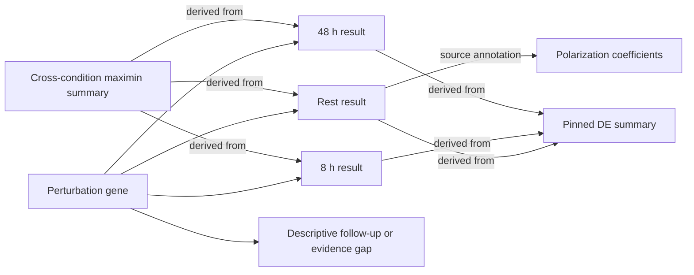
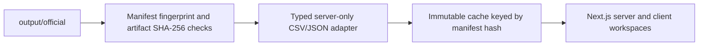

# Next.js Analyst Workspace Implementation Report

Date: 2026-07-27  
Status: Implemented and validated

## Outcome

The project now includes a production-buildable Next.js analyst interface under `web/`. It turns
the existing CD4+ Perturb-seq source-QC outputs into a traceable investigation workspace rather
than a collection of static tables and figures.

The interface is deliberately decision-oriented: analysts can find a candidate, understand why it
passed, trace its evidence lineage, compare it with other candidates, challenge its ranking
assumptions, and export a bounded finding without overstating the biological evidence.

Current pinned bundle:

- 33,983 audited perturbation-condition rows
- 1,652 source-QC passing rows
- 224 three-condition candidates
- Leading maximin candidate: SETDB1
- Manifest SHA-256:
  `0f01f3dc1c9846e0dc37f8c56468a5944d7ecb7e1d3fc473a82c96f071edbe3a`

## What was implemented

| Route | Workspace | Main capabilities |
| --- | --- | --- |
| `/` | Registered-run overview | Run contract, headline metrics, condition leaders, and cumulative filter funnel |
| `/explore` | Candidate explorer | Gene search, condition and score filters, three-condition filter, accessible sorting, and expandable results |
| `/genes/[gene]` | Gene dossier | Condition metrics, score anatomy, evidence graph, source annotations, evidence gaps, claim boundary, and next-evidence guidance |
| `/compare` | Gene comparison | Up to five candidates, aligned condition profiles, and raw component comparison |
| `/robustness` | Robustness lab | Exploratory geometric-mean reweighting, rank agreement, top-10 overlap, and largest-mover analysis |
| `/findings` | Finding cards | Deterministic, conservative Markdown claim generation with evidence, limitations, gaps, and a next experiment |
| `/provenance` | Provenance ledger | Source URLs, source and artifact hashes, hard gates, runtime versions, and the complete bundle fingerprint |

## Knowledge graph

The dossier now uses `@xyflow/react` 12.11.2 with `elkjs` 0.12.0. React Flow renders every
evidence node as a semantic React component, while ELK calculates a deterministic layered layout
only when graph topology or direction changes. Analysts can still drag nodes without a
continuously moving force simulation.



Graph semantics:

- Condition nodes are registered source-QC results.
- The cross-condition node is a derived summary, not independent corroboration.
- Polarization coefficients are source annotations, not replication.
- IL-10/IL-21 rows are descriptive arrayed follow-up, not confirmatory validation.
- Missing follow-up is rendered as an evidence gap, not a negative biological finding.
- All loaded source annotations are represented; the graph no longer silently truncates the
  adapter's bounded annotation set.
- Hovering previews a one-hop neighborhood; selecting a node locks that focus and dims unrelated
  evidence without hiding it.
- Search results center the selected node and its direct neighbors.
- The inspector exposes clickable incoming and outgoing relationships using the registered
  relation vocabulary.
- Analysts can switch between horizontal and vertical ELK layouts, show every relation label,
  filter annotations or provenance, reset canonical positions, fit the full graph, zoom, pan, and
  use a minimap on larger screens.
- Every node and edge is keyboard-focusable. Nodes expose useful names and metrics to assistive
  technology, while the inspector announces selection changes.
- On narrow screens, the initial viewport favors a readable gene neighborhood; "Fit graph" remains
  available for a whole-network overview.

### Stack decision

Three current graph stacks were compared:

| Stack | Fit for this project | Decision |
| --- | --- | --- |
| React Flow + ELK | Custom DOM/React nodes, built-in controls and minimap, keyboard support, and stable directional layout | Selected for the explanation-heavy 7-17 node evidence graph |
| Cytoscape.js + fCoSE | Strong graph algorithms and a low-migration path, but canvas-rendered node cards are less natural to integrate with the React inspector and accessibility model | Retained as a valid option for computation-heavy graph work |
| Sigma.js + Graphology | WebGL performance for graphs with thousands of elements | Better reserved for a future large-network exploration mode |

Primary references:

- [React Flow custom nodes](https://reactflow.dev/learn/customization/custom-nodes)
- [React Flow built-in controls, minimap, background, and panels](https://reactflow.dev/learn/concepts/built-in-components)
- [React Flow accessibility](https://reactflow.dev/learn/advanced-use/accessibility)
- [React Flow layout guidance](https://reactflow.dev/learn/layouting/layouting)
- [Eclipse ELK layered algorithm](https://eclipse.dev/elk/reference/algorithms/org-eclipse-elk-layered.html)

## Data and deployment architecture

The Next.js server reads the generated bundle directly; no second copy of the analytical logic was
introduced.



Key implementation decisions:

- Blank numeric cells are rejected or preserved as `null` where the source contract permits them;
  they are never coerced to zero.
- Boolean and enum-like fields are parsed strictly.
- The app fingerprints `provenance/manifest.json` at startup.
- Every displayed artifact is verified against the SHA-256 registered in that manifest.
- Cached data is namespaced by the manifest fingerprint and does not revalidate within the running
  deployment. An intentional bundle change requires an app restart or new deployment.
- `ANALYSIS_OUTPUT_DIR` can point to another equivalent generated bundle.
- Next.js output tracing is rooted at the repository and explicitly includes
  `output/official/**/*`, so dynamic dossier, comparison, and finding routes receive their runtime
  data in a production package.
- Local source paths from the manifest are never exposed as browser links.

Primary implementation areas:

- `web/src/lib/data.ts`: typed parsing, integrity verification, immutable caching, joins, and
  dossier assembly
- `web/src/components/evidence-graph.tsx`: graph construction, evidence semantics, responsive
  fitting, ELK layout, search, focus highlighting, filters, and accessible node inspection
- `web/src/components/candidate-explorer.tsx`: TanStack Table search, filtering, and sorting
- `web/src/components/robustness-lab.tsx`: exploratory reweighting and rank diagnostics
- `web/src/components/finding-card-builder.tsx`: constrained claim and Markdown export
- `web/src/app/`: route composition, metadata, loading, error, empty, and not-found states

## Scientific guardrails

The UI language and interactions explicitly prevent common overclaims:

- A priority score is presented as a relative triage heuristic, not a probability, p-value,
  confidence score, effect size, safety signal, or druggability measure.
- `n_downstream` is described as a power-sensitive source discovery count.
- Positive donor and guide concordance values are not described as independent replication.
- A false source off-target flag is not described as proof of being off-target-free.
- Funnel exclusion is not equated with absence of biological effect.
- Rank or weakest-condition differences are not presented as a condition interaction.
- Source coefficients are not presented as a reproduced mechanism.
- Candidate language remains "source-QC candidate" or "reproducible candidate according to the
  supplied metrics," never "validated target" or "verified hit."
- The robustness lab only reweights the three existing percentiles among already eligible rows. It
  does not change hard gates, recompute source statistics, or create a new registered result.

## UI and accessibility

The visual system now uses a restrained dark scientific-workbench style: green-tinted charcoal
surfaces, soft off-white text, one teal action accent, tabular numerics, a low-contrast structural
grid, and limited motion. The theme declares `color-scheme: dark`, so native controls and browser
UI match the application. Shadows use a separate dark token instead of inheriting the light
foreground color.

Responsive and accessibility work includes:

- Desktop sidebar and an accessible mobile dialog navigation with focus containment, inert
  background content, Escape dismissal, focus restoration, and vertical overflow.
- Mobile-safe metric bands and condition-leader columns.
- Horizontally explorable data tables where their full analytical width is necessary.
- Announced segmented-control selection with `aria-pressed`.
- Sort direction exposed through `aria-sort`.
- Keyboard-focusable evidence nodes and edges, search-to-focus, persistent selection, and an
  `aria-live` inspector.
- Distinct secondary and faint text levels, plus brighter warning, danger, and success roles for
  dark-surface contrast.
- Graph controls and filters use at least 44 px touch targets.
- The minimap is removed on mobile, where the canvas opens on the readable primary neighborhood.
- Visible focus states, reduced-motion handling, loading skeletons, error recovery, empty states,
  and copy-to-clipboard failure feedback.

## Validation performed

| Check | Result |
| --- | --- |
| Python test suite | `32 passed in 35.96s` |
| Python Ruff scan | Passed for `src`, `tests`, and `scripts` |
| TypeScript | `npm run typecheck` passed |
| ESLint | `npm run lint` passed with no warnings |
| Production build | Next.js 16.2.12 build passed |
| Route generation | 9 static/dynamic application routes generated successfully |
| Production dependency audit | 3 high-severity transitive advisories reported under Next.js (`postcss` and `sharp`); npm currently offers only a breaking `--force` resolution, so no automatic dependency rewrite was applied |
| Production file tracing | Compare, findings, and gene route traces each include 18 official artifacts, including the manifest and candidate table |
| Desktop visual QA | Dark dossier and graph inspected at 1440 x 900 |
| Mobile visual QA | Dark dossier, readable graph neighborhood, touch controls, and stacked inspector checked at 390 x 844 |

Interaction checks completed:

- Searching `GATA3` reduced the explorer to its three eligible condition rows.
- The priority-score column announced descending sort state.
- Repeated comparison query keys loaded SETDB1 and AHR without a server error.
- Repeated finding query keys selected the first valid requested gene without producing a false
  empty-condition claim.
- The registered robustness baseline reported `None` and `No rank changes` for largest mover.
- Switching robustness conditions updated both the view and pressed-state semantics.
- Search for `Rest` returned the condition result and both matching annotations; selecting the
  result centered its neighborhood and synchronized the inspector.
- Selecting a result emphasized one node, retained five direct relations, and dimmed seven
  unrelated nodes.
- Enabling relation labels rendered all 17 relationship labels.
- Hiding source annotations reduced the graph from 13 nodes / 17 relations to 7 nodes / 11
  relations and recomputed the ELK layout.
- Switching to the vertical layout preserved the seven filtered nodes without browser errors.
- Desktop and mobile canvases rendered keyboard-focusable React Flow node groups.
- Mobile navigation trapped focus, closed on Escape, and restored focus to its opener.

One development-browser hydration warning was observed from Grammarly-injected `<body>` attributes;
the rendered diff contained only the extension's attributes and no application markup mismatch.

## Running the interface

From the repository root:

```powershell
Set-Location web
npm ci
npm run dev
```

Then open `http://localhost:3000`.

For an alternate generated bundle:

```powershell
$env:ANALYSIS_OUTPUT_DIR = "C:\absolute\path\to\output\official"
npm run dev
```

The alternate directory must contain the same table, summary, and provenance contract. If its
contents do not match the hashes in its manifest, the app fails closed instead of mixing runs.

## Remaining opportunities

The implemented workspace is intentionally read-only and local to an analysis bundle. A sensible
next phase would add persisted investigation cases: saved gene sets, analyst notes, graph
bookmarks, finding-card review status, and shareable case links. That should be introduced with
authentication, explicit project-level access control, and an audit trail rather than silently
writing back into the registered analysis outputs.

Additional future analytical value could come from an independently registered
perturbation-by-condition model, orthogonal replication results, and configurable graph expansion
across external pathway or literature sources. Those should appear as new evidence layers with
their own provenance and strength labels, not be blended into the existing source-QC score.
