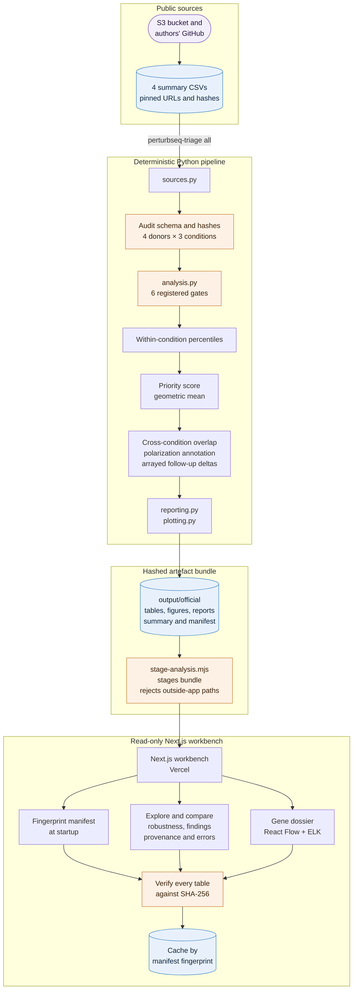

# CD4+ Perturb-seq Source-QC Triage

This repository now uses the T-cell dataset recommended by the
[Built with Claude: Life Sciences](https://cerebralvalley.ai/e/built-with-claude-life-sciences)
research track: the official
[Primary Human CD4+ T Cell Perturb-seq dataset](https://virtualcellmodels.cziscience.com/dataset/genome-scale-tcell-perturb-seq).

The dataset is a genome-scale CRISPRi screen of approximately **22 million primary human CD4+
T cells** from **four donors** in **Rest, Stim8hr, and Stim48hr** conditions. The project asks:

> Which perturbations have broad downstream transcriptional effects that also pass transparent
> on-target, cell-count, off-target-flag, cross-donor, and cross-guide source-QC checks within each
> culture condition?

The answer is a prioritized list of **source-QC candidates** within each condition, plus
**reproducible candidates** that pass the same gates in all three conditions. It is not an
independent reanalysis of the 22 million cells, and it is not experimental validation.

## Run the official workflow

From this repository in Windows PowerShell:

```powershell
uv sync --extra dev
uv run perturbseq-triage all --data-dir data/official --output-dir output/official
uv run jupyter lab notebooks/02_cd4_perturbseq_official_tutorial.ipynb
```

The `all` command downloads the small public summary tables, audits them, applies the registered
gates, ranks candidates, adds source-reported polarization annotations, summarizes cross-condition
overlap, and analyzes the authors' arrayed IL-10/IL-21 follow-up descriptively. It does **not**
download the full cell matrices.

Start with these learning resources:

- [Official tutorial notebook](./notebooks/02_cd4_perturbseq_official_tutorial.ipynb) - the guided,
  executable path through the real-data outputs.
- [Learn the outputs](./docs/LEARN_THE_OUTPUTS.md) - what every table and figure means, and what it
  cannot support.
- [Generated official report](./output/official/report.md) - the result-first summary from the
  pinned default run.
- [Generated methods](./output/official/methods.md) - the exact gates, ranking formula, and
  inference boundary used by that run.
- [Official dataset guide](./docs/OFFICIAL_DATASET.md) - sources, scale, fields, download strategy,
  and limitations.
- [Project brief](./PROJECT.md) - the scientific question and pre-registered triage contract.
- [Submission checklist](./docs/SUBMISSION_CHECKLIST.md) - the human review required before
  presenting the work.

## Why the summary-table route is primary

The public S3 prefix contains 12 cell-level `.h5ad` files - four donors times three conditions.
Together they occupy **1,735,835,115,866 bytes**, or approximately **1.58 TiB**. Even the merged
pseudobulk and differential-expression matrices are tens of gigabytes. That is inappropriate for
a learning laptop and unnecessary for this project's question.

Instead, the workflow uses four public files:

| Input | Purpose |
|---|---|
| `DE_stats.suppl_table.csv` | One row per perturbation-condition result, including source-reported on-target, downstream-effect, donor, and guide metrics. |
| `sample_metadata.suppl_table.csv` | Confirms the four-donor, three-condition sample design. |
| `polarization_prediction_condition_comparison_regulator_coefficients.csv` | Authors' model coefficients for activation/polarization signatures; joined as descriptive candidate annotation only. |
| `IL10_IL21_arrayed_validation.csv` | Authors' small arrayed follow-up; used only for donor-matched descriptive deltas. |

The files are available from the public
[`s3://genome-scale-tcell-perturb-seq/marson2025_data/`](https://genome-scale-tcell-perturb-seq.s3.amazonaws.com/?list-type=2&prefix=marson2025_data/)
bucket and the authors'
[GitHub supplementary-table directory](https://github.com/emdann/GWT_perturbseq_analysis_2025/tree/master/metadata/suppl_tables).
See [the dataset guide](./docs/OFFICIAL_DATASET.md) for exact URLs and artifact sizes.

## Transparent triage contract

A perturbation-condition row is eligible only when all of these are true:

1. `ontarget_significant == True`;
2. `ontarget_effect_size < 0`, consistent with CRISPRi knockdown;
3. `offtarget_flag == False`;
4. `n_cells_target >= 100`;
5. `crossdonor_correlation_min` is present and greater than zero;
6. `crossguide_correlation` is present and greater than zero.

Eligible rows are ranked **within culture condition**. The source donor/guide fields are renamed
`crossdonor_min` and `crossguide` in the output. The three exact percentile columns are combined as:

```text
priority_score = (n_downstream_percentile
                  * crossdonor_min_percentile
                  * crossguide_percentile) ** (1/3)
```

The geometric mean rewards candidates that are reasonably strong on all three axes instead of
letting one exceptional metric fully hide a weak one. The score is a prioritization heuristic, not
a probability, p-value, or effect size.

`n_downstream` is the authors' count of downstream discoveries at 10% FDR. It is influenced by
cell count and statistical power and must not be described as the magnitude of a perturbation.
The donor and guide correlations are also author-reported source statistics; this lightweight
workflow audits and uses them but does not independently recompute them from raw counts.

## System Design

The system has two parts: a deterministic Python triage pipeline that produces a hashed artefact bundle, and a read-only Next.js workbench that serves that bundle to analysts. The bundle is the contract between them.

### Requirements

**Functional**
- Audit the official CD4+ Perturb-seq summary tables, apply the registered source-QC gates, rank candidates within each condition, and summarise cross-condition overlap.
- Let analysts explore, compare, and stress-test the ranking (reweighting), inspect a gene dossier with an evidence graph, and draft constrained finding cards.

**Non-functional**
- **Laptop scale**: avoid the 1.58 TiB cell-level matrices; work from four public summary files.
- **Reproducibility and integrity**: pinned inputs, schema and hash audits, and a provenance manifest; the web app refuses tables whose SHA-256 differs from the manifest.
- **Claim safety**: outputs and UI language stay within the documented inference boundary.

### Architecture



### Key Design Choices

- **Summary-table route instead of a cell-level reanalysis.** It answers the registered question with megabytes instead of terabytes, at the cost of relying on author-reported statistics, which the documentation states plainly.
- **Geometric-mean priority score.** One exceptional metric cannot hide a weak one; the score is presented as a heuristic, not a probability or effect size.
- **Immutable, verified bundle.** The workbench is read-only and content-addressed by manifest, so what an analyst sees always matches a specific pipeline run.
- **Exploration separated from the registered result.** `/robustness` reweighting is labelled exploratory and never overwrites the pinned ranking.

### Trade-offs

| Decision | Benefit | Cost |
| --- | --- | --- |
| Author-reported donor and guide correlations | Feasible on a laptop | Not independently recomputed from raw counts |
| Ranking within each condition | Avoids comparing different experimental contexts | Cross-condition differences remain descriptive |
| Bundle baked in at build time | Fast, static-like serving; strong provenance | New results require a rebuild and redeploy |
| Cache by manifest fingerprint | No repeated hashing per request | Switching bundles requires a restart |

### What to Revisit as It Grows

- Add a cloud pseudobulk path (for example on a cluster or a managed notebook) to recompute concordance from raw counts.
- Fit a formal perturbation-by-condition interaction model before making any condition-difference claims.
- Version bundles in object storage and let the workbench switch between registered runs.

## Outputs

The official run writes its artifacts under `output/official/`:

| Artifact | Question it answers |
|---|---|
| `provenance/source_audit.json` / `tables/sample_design_summary.csv` | Did the files match the required schema, hashes, and four-donor/three-condition design? |
| `tables/source_qc_decisions.csv` | Which gate did every source row pass or fail? |
| `tables/filter_funnel.csv` / `figures/01_filter_funnel.png` | How many rows survive each transparent gate? |
| `tables/candidate_scores.csv` | Which eligible perturbations rank highest within each condition, and why? |
| `tables/top_candidates_by_condition.csv` / `figures/02_top_candidates.png` | What is the concise shortlist for Rest, Stim8hr, and Stim48hr? |
| `tables/cross_condition_candidates.csv` / `figures/03_cross_condition_scores.png` | Which genes pass all gates in all three conditions, ranked by their weakest condition score? This is descriptive, not an interaction test. |
| `tables/candidate_polarization_coefficients.csv` | Which source activation/polarization coefficient rows annotate source-QC-pass genes? |
| `tables/validation_donor_deltas.csv` / `tables/validation_summary.csv` | How do reported IL-10/IL-21 percentages differ from donor-matched non-targeting controls? |
| `figures/04_arrayed_validation_deltas.png` | What do the available donor-matched follow-up deltas look like? |
| `report.md`, `methods.md`, `run_summary.json`, `provenance/manifest.json` | What ran, what resulted, and how can the run be traced? |

Use [Learn the outputs](./docs/LEARN_THE_OUTPUTS.md) before interpreting any ranking.

## Known result from the pinned default run

Using the four pinned files, the registered 100-cell gate, and default score:

- source-QC passes: **497 Rest**, **593 Stim8hr**, and **562 Stim48hr** rows;
- **224 genes** pass every gate in all three conditions;
- **SETDB1** is the leading cross-condition candidate, with a minimum condition score of
  approximately **0.915**; its weakest score is in Stim8hr;
- the leading within-condition rows are SETDB1 in Rest and ARNT in Stim8hr and Stim48hr.

These are deterministic prioritization results from the source summaries. They are not effect-size,
interaction, therapeutic, or validation claims.

## Claim boundary

Safe language:

- "passed the registered source-QC gates";
- "ranked highly among eligible perturbations in Stim8hr";
- "showed positive author-reported cross-donor and cross-guide concordance";
- "passed source QC in all three conditions and is a reproducible candidate for independent
  follow-up" - only when the row is in the cross-condition table.

Unsafe language:

- "verified" or "validated" by this workflow;
- "has a larger biological effect" merely because `n_downstream` is larger;
- "works better in Stim48hr" based only on different condition-specific ranks;
- "is a drug target" without independent functional and safety evidence.

Cross-condition differences are descriptive because this workflow does not fit a formal
perturbation-by-condition interaction model. The IL-10/IL-21 analysis is also descriptive; the
source filename contains the word `validation`, but that does not turn this project's summaries
into independent validation.

The polarization coefficients are also author-reported model outputs. Joining them to candidates
adds biological context; it is not an independent replication or a new polarization-effect test.

## Legacy synthetic CD8+ teaching fallback

The earlier CD8+ exhaustion project remains available as a clearly labeled **synthetic teaching
fixture**. It is useful for learning Scanpy, donor-level pseudobulk, UMAP, and false-discovery-rate
concepts, but it is not the organizer dataset and is not biological evidence.

```powershell
uv run tcell-triage demo --evidence evidence/literature_evidence.csv
uv run jupyter lab notebooks/01_cd8_exhaustion_triage_tutorial.ipynb
```

Legacy references:

- [Synthetic CD8+ tutorial](./notebooks/01_cd8_exhaustion_triage_tutorial.ipynb)
- [Demo data dictionary](./docs/DEMO_DATA_DICTIONARY.md)
- [Legacy real-data adapter checklist](./docs/REAL_DATA_CHECKLIST.md)

Never present `output/demo/` as an analysis of the official dataset.

## Developer checks

```powershell
uv run pytest -q
uv run ruff check src tests scripts
uv run jupyter nbconvert --to notebook --execute --inplace --ExecutePreprocessor.timeout=600 notebooks/02_cd4_perturbseq_official_tutorial.ipynb
```

The package targets Python 3.11-3.13 and pins its dependency graph in `uv.lock`.
